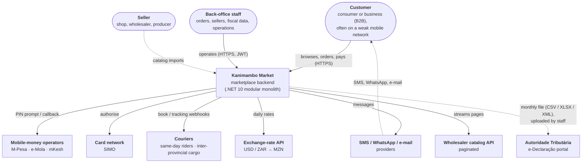
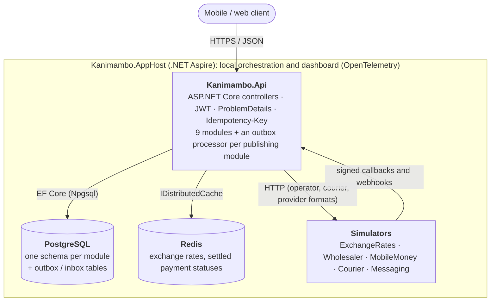
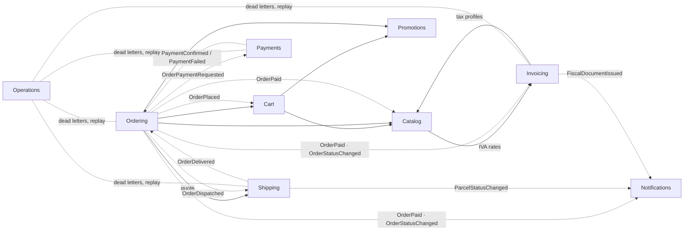

# Kanimambo Market

[](https://github.com/edilsonmanjate/kanimambo-market/actions/workflows/ci.yml)


A marketplace backend for Mozambique, built as a **design patterns showcase in .NET 10**.
Each of the 26 patterns below solves a real business problem of the Mozambican market:
M-Pesa / e-Mola / mKesh mobile-money payments, IVA and ISPC tax regimes, monthly invoice
reporting to the Autoridade Tributária (e-Declaração), same-day delivery by *txopela* in Maputo,
and customers on unstable mobile networks.

> **Rule of the project:** no pattern is applied "just because". Every pattern document shows the
> naive solution, why it hurts, and when *not* to use the pattern.

*Kanimambo* means "thank you" in Changana.

## Status

**All 26 patterns implemented, all 8 phases done.** To see the whole system work in one command, go to
[See it work](#see-it-work).

- **Phase 0 – Foundations:** solution layout, Aspire orchestration, SharedKernel (with the in-house
  **Mediator**), the API host with ProblemDetails and `Idempotency-Key` support, architecture tests and CI.
- **Phase 1 – Catalog:**
  - sellers, products and nested bundles (**Composite**);
  - shared variant attributes (**Flyweight**);
  - SQL-translated search filters (**Specification**);
  - streaming the wholesaler API (**Iterator**);
  - CSV, Excel, XML and API imports (**Template Method**);
  - an audited, undoable back-office (**Command**);
  - cached, rate-limited exchange rates (**Proxy**).
- **Phase 2 – Cart & Promotions:**
  - carts with a snapshot history that survives lost connectivity (**Memento**);
  - pricing without null checks for guests, MZN prices and "no promotion" (**Null Object**);
  - a rule language marketing writes and the system evaluates at runtime (**Interpreter**).
- **Phase 3 – Ordering & Checkout:**
  - an order lifecycle where invalid transitions cannot happen (**State**);
  - configurable acceptance checks (**Chain of Responsibility**);
  - B2B reorders cloned from last week (**Prototype**);
  - one checkout operation over nine subsystems (**Facade**);
  - events delivered to other modules through a transactional outbox with per-subscriber retry (**Observer**).
- **Phase 4 – Payments:**
  - the payment processor chosen by phone prefix: 84/85 M-Pesa, 86/87 e-Mola, 82/83 mKesh (**Factory Method**);
  - three operator formats behind one gateway with unified errors and signed callbacks (**Adapter**);
  - logging, metrics, caching of final statuses and business-aware retry around every operator (**Decorator**);
  - an asynchronous payment lifecycle with PIN timeouts and late confirmations (**State**);
  - a local mobile-money simulator whose failure scenarios are chosen by the phone number
    ([ADR 0008](docs/adr/0008-asynchronous-mobile-money-payments.md)).
- **Phase 5 – Shipping:**
  - delivery priced by interchangeable rules: same-day by zone and vehicle, courier by destination and weight,
    free pickup points, all from configuration (**Strategy**);
  - two courier formats behind one gateway, with signed tracking webhooks (**Adapter**);
  - one parcel per seller, and an order delivered (cash orders paid) when the last parcel arrives
    ([ADR 0009](docs/adr/0009-shipping-consignments-and-couriers.md)).
- **Phase 6 – Invoicing:**
  - always-valid invoices: NUITs, gapless series numbers, IVA extracted per line, legal reasons for exemptions (**Builder**);
  - coherent tax calculator, formatter and series per seller regime, IVA normal or ISPC (**Abstract Factory**);
  - the monthly e-Declaração file (CSV, XLSX, XML), the invoice PDF and the IVA summary as visitors of one document tree (**Visitor**);
  - pooled PDF writers and buffers for bulk month-end generation, about 50% fewer allocations (**Object Pool**);
  - one cached, thread-safe, reloadable IVA rate table with legal history, and feature flags (**Singleton** through DI,
    [ADR 0010](docs/adr/0010-singletons-through-di.md));
  - prices include IVA; sellers issue their own invoices and issuing never blocks on missing fiscal data
    ([ADR 0011](docs/adr/0011-invoicing.md)).
- **Phase 7 – Notifications:**
  - message types (confirmation, payment reminder, delivery update, invoice available) × channels (SMS, WhatsApp, e-mail)
    as two independent hierarchies, combined per customer at send time (**Bridge**);
  - SMS in GSM-7 within 160 characters, fallback to the next preferred channel instead of blind retries
    ([ADR 0012](docs/adr/0012-notifications.md)).
- **Phase 8 – Polish:**
  - C4 context and container diagrams, plus the modules and the events between them ([Architecture](#architecture));
  - the whole journey as an [`.http` walkthrough](http/kanimambo-journey.http) and a one-command
    [demo](docs/demo.md) that runs it;
  - an operations view of every module's outbox, with dead-letter replay (Operations module, ADR 0007);
  - idempotency keys scoped to the signed-in caller (ADR 0003);
  - every source file holds one type, enforced by an architecture test;
  - build and coverage badges published by CI.

## Design patterns index

Legend: ✅ implemented · 🟡 partially implemented · ⏳ planned

### Behavioral

| Pattern | Business problem | Module | Phase | Status | Docs |
|---|---|---|---|---|---|
| Chain of Responsibility | Order acceptance checks (NUIT, stock, delivery zone, anti-fraud, seller minimum), order set in DI | Ordering | 3 | ✅ | [Chain of Responsibility](docs/patterns/ChainOfResponsibility.md) |
| Command | Auditable, undoable back-office operations (bulk price change, suspend seller) | Catalog | 1 | ✅ | [Command](docs/patterns/Command.md) |
| Interpreter | Marketing-authored promotion rules (tokenizer, parser, typed AST) evaluated at runtime | Promotions | 2 | ✅ | [Interpreter](docs/patterns/Interpreter.md) |
| Iterator | Streaming a slow, paginated wholesaler catalog as `IAsyncEnumerable` | Catalog | 1 | ✅ | [Iterator](docs/patterns/Iterator.md) |
| Mediator | In-process dispatch of commands/queries/notifications with ordered pipeline behaviors | SharedKernel | 0 | ✅ | [Mediator](docs/patterns/Mediator.md) |
| Memento | Cart snapshots for customers who lose connectivity: restore snapshot N, undo | Cart | 2 | ✅ | [Memento](docs/patterns/Memento.md) |
| Observer | `OrderPaid` → stock reservation, invoices and the customer's SMS; payments and deliveries report back the same way, through transactional outboxes | Transversal | 3–7 | ✅ | [Observer](docs/patterns/Observer.md) |
| State | Order lifecycle (prepaid and cash on delivery) and asynchronous mobile-money payments (PIN, timeout, late confirmation) | Ordering, Payments | 3–4 | ✅ | [State](docs/patterns/State.md) |
| Strategy | Shipping cost: same-day by zone and vehicle, courier by destination and weight, free pickup points | Shipping | 5 | ✅ | [Strategy](docs/patterns/Strategy.md) |
| Template Method | Seller catalog imports (CSV, Excel, XML, wholesaler API) with fixed steps and per-format hooks | Catalog | 1 | ✅ | [Template Method](docs/patterns/TemplateMethod.md) |
| Visitor | Fiscal document tree → e-Declaração CSV/XLSX/XML, invoice PDF, IVA summary (SAF-T later = one more visitor) | Invoicing | 6 | ✅ | [Visitor](docs/patterns/Visitor.md) |

### Creational

| Pattern | Business problem | Module | Phase | Status | Docs |
|---|---|---|---|---|---|
| Abstract Factory | Coherent component families per tax regime (IVA normal vs ISPC); mixing them is impossible | Invoicing | 6 | ✅ | [Abstract Factory](docs/patterns/AbstractFactory.md) |
| Builder | Always-valid `Invoice` (NUITs, gapless series numbers, exemptions, MZN totals) | Invoicing | 6 | ✅ | [Builder](docs/patterns/Builder.md) |
| Factory Method | Payment processor by phone prefix (84/85 M-Pesa, 86/87 e-Mola, 82/83 mKesh, from configuration) | Payments | 4 | ✅ | [Factory Method](docs/patterns/FactoryMethod.md) |
| Null Object | `GuestCustomer`, `NoPromotion`, `NoExchangeRate` remove null checks from cart pricing | Cart, Promotions | 2 | ✅ | [Null Object](docs/patterns/NullObject.md) |
| Object Pool | Pooled PDF writers and buffers for bulk PDF and monthly AT file generation (−50% allocations) | Invoicing | 6 | ✅ | [Object Pool](docs/patterns/ObjectPool.md) |
| Prototype | Weekly B2B reorders deep-cloned from the previous order, then adjusted (with undo) | Ordering | 3 | ✅ | [Prototype](docs/patterns/Prototype.md) |
| Singleton | Cached, reloadable IVA rate table (with legal history) and feature flags via DI lifetime, never `static Instance` | Transversal | 6 | ✅ | [Singleton](docs/patterns/Singleton.md) |

### Structural

| Pattern | Business problem | Module | Phase | Status | Docs |
|---|---|---|---|---|---|
| Adapter | M-Pesa / e-Mola / mKesh and two couriers, each behind one gateway with unified errors | Payments, Shipping | 4–5 | ✅ | [Adapter](docs/patterns/Adapter.md) |
| Bridge | Message types × channels (SMS in GSM-7 ≤160 chars, WhatsApp, e-mail): 7 classes instead of 12, channel chosen per customer | Notifications | 7 | ✅ | [Bridge](docs/patterns/Bridge.md) |
| Composite | Bundles ("cabaz do mês") with recursive price, weight, stock and per-item IVA | Catalog | 1 | ✅ | [Composite](docs/patterns/Composite.md) |
| Decorator | Logging, metrics, caching of final statuses and business-aware retry around mobile-money gateways | Payments | 4 | ✅ | [Decorator](docs/patterns/Decorator.md) |
| Facade | `CheckoutService` orchestrating cart, prices, rates, promotions, shipping, acceptance, order, payment, idempotency | Ordering | 3 | ✅ | [Facade](docs/patterns/Facade.md) |
| Flyweight | 100k product variants sharing interned immutable attributes (−52% retained memory) | Catalog | 1 | ✅ | [Flyweight](docs/patterns/Flyweight.md) |
| Proxy | Cache + rate limit in front of a slow USD/ZAR → MZN exchange-rate API | Catalog | 1 | ✅ | [Proxy](docs/patterns/Proxy.md) |
| Specification | Composable catalog filters translated to SQL by EF Core | Catalog | 0–1 | ✅ | [Specification](docs/patterns/Specification.md) |

## Architecture

A **modular monolith** with Clean Architecture inside each module. Modules communicate only through
public contracts and events, never through each other's `DbContext`
([ADR 0001](docs/adr/0001-modular-monolith.md)).

### Level 1: system context (C4)

Who uses Kanimambo Market, and which outside systems it depends on. Every external system has a local
simulator, so the project runs without any real credential.



### Level 2: containers (C4)



### Inside the monolith: modules and events

Solid arrows are synchronous calls through a module's `*.Contracts` interfaces. Dotted arrows are
integration events, delivered by the publishing module's transactional outbox
([ADR 0007](docs/adr/0007-transactional-outbox.md)).



Every request goes through the in-house Mediator, whose pipeline runs Logging → Validation →
UnitOfWork → Idempotency ([ADR 0002](docs/adr/0002-in-house-mediator.md)).

```
src/
  Kanimambo.AppHost/                    .NET Aspire orchestration (PostgreSQL, Redis, API, simulators)
  Kanimambo.ServiceDefaults/            OpenTelemetry, health checks, service discovery, resilience
  Kanimambo.Api/                        Host: module registration, ProblemDetails, auth, idempotency middleware
  Kanimambo.SharedKernel/               Entity, AggregateRoot, DomainEvent, Result<T>, Money, Specification, Mediator
  Kanimambo.SharedKernel.Web/           ApiControllerBase (Result → ProblemDetails), shared HTTP attributes
  Kanimambo.SharedKernel.Infrastructure/ EF unit of work, inbox, per-module DbContext registration
  Modules/Catalog/                      {Api, Application, Contracts, Domain, Infrastructure}
  Modules/Promotions/                   {Api, Application, Contracts, Domain, Infrastructure}
  Modules/Cart/                         {Api, Application, Contracts, Domain, Infrastructure}
  Modules/Ordering/                     {Api, Application, Contracts, Domain, Infrastructure}
  Modules/Payments/                     {Api, Application, Contracts, Domain, Infrastructure}
  Modules/Shipping/                     {Api, Application, Contracts, Domain, Infrastructure}
  Modules/Invoicing/                    {Api, Application, Contracts, Domain, Infrastructure}
  Modules/Notifications/                {Api, Application, Domain, Infrastructure}
  Modules/Operations/                   {Api, Application, Infrastructure}: outbox health and dead-letter replay
  Simulators/                           ExchangeRates, Wholesaler, MobileMoney, Courier, Messaging
tests/
  Kanimambo.SharedKernel.UnitTests/
  Kanimambo.Catalog.UnitTests/  Kanimambo.Promotions.UnitTests/  Kanimambo.Cart.UnitTests/  Kanimambo.Ordering.UnitTests/
  Kanimambo.Payments.UnitTests/  Kanimambo.Shipping.UnitTests/  Kanimambo.Invoicing.UnitTests/  Kanimambo.Notifications.UnitTests/
  Kanimambo.Api.IntegrationTests/       WebApplicationFactory + Testcontainers (PostgreSQL, Redis)
  Kanimambo.Catalog.IntegrationTests/   real API + in-process simulators
  Kanimambo.Promotions.IntegrationTests/  Kanimambo.Cart.IntegrationTests/  Kanimambo.Ordering.IntegrationTests/
  Kanimambo.Payments.IntegrationTests/  real API + mobile-money simulator with compressed delays
  Kanimambo.Shipping.IntegrationTests/  real API + courier simulator with compressed delays
  Kanimambo.Invoicing.IntegrationTests/  Kanimambo.Notifications.IntegrationTests/
  Kanimambo.ArchitectureTests/          NetArchTest layer and module rules; one type per source file (Roslyn)
  Kanimambo.Benchmarks/                 BenchmarkDotNet (Flyweight, Object Pool)
  Kanimambo.Testing/                    shared test host and JWT helpers
docs/
  patterns/                   one document per pattern
  adr/                        architecture decision records
  demo.md                     transcript of the end-to-end demo
http/kanimambo-journey.http   the whole journey, request by request
scripts/demo.cs               runs that walkthrough and narrates it (dotnet run scripts/demo.cs)
```

### Cross-cutting behavior

- **Errors.** Business failures travel as `Result`/`Result<T>` with a typed `Error`. They become
  RFC 9457 ProblemDetails with a stable `code` field (for example `ordering.below_seller_minimum`).
  Exceptions are kept for bugs and outages and return a generic 500 response that leaks no details.
- **Idempotency.** Every write endpoint accepts `Idempotency-Key`. A retry gets back the stored first
  response, marked `Idempotent-Replayed: true`. Reusing a key with a different payload returns 422.
  A retry that arrives while the first request is still running returns 409. 5xx responses are not
  stored, so the client can retry. A key belongs to the endpoint and the signed-in caller, so two
  customers never see each other's stored response. Internal re-deliveries (outbox, payment callbacks)
  are de-duplicated by the Mediator's `IdempotencyBehavior` ([ADR 0003](docs/adr/0003-idempotency.md)).
- **Operations.** Every publishing module's outbox is visible to the back-office
  (`GET /api/operations/outbox`). A message that failed `Outbox:MaxAttempts` times is dead-lettered, and
  once the cause is fixed it can be replayed for the subscribers that missed it.
- **Time.** `TimeProvider` is injected everywhere; nothing reads `DateTime.Now`.
- **Money.** `Money` is a `decimal` value object, rounded to 2 decimal places with
  `MidpointRounding.AwayFromZero`. Mixing currencies without an explicit conversion throws.

## Getting started

Prerequisites: [.NET SDK 10.0.402+](https://dotnet.microsoft.com/download) and Docker. The project
needs **no real credentials**: every external gateway runs as a local simulator.

```bash
# Run everything (PostgreSQL, Redis, simulators, API) with the Aspire dashboard.
# In Development the database is migrated and seeded with demo sellers in Maputo, Matola, Beira and Nampula.
dotnet run --project src/Kanimambo.AppHost --launch-profile http

# API reference (Scalar) while the AppHost runs
open http://localhost:5080/scalar

# Build and test (integration tests start their own containers)
dotnet tool restore
dotnet build Kanimambo.slnx
dotnet test --solution Kanimambo.slnx
```

### See it work

With the AppHost running, one command takes an order through the whole system:

```bash
dotnet run scripts/demo.cs
```

1. Search the catalog and open a bundle.
2. Fill a cart, see the M-Pesa promotion and the delivery options.
3. Check out with M-Pesa. The simulated customer types the PIN, the operator calls back, and the order
   is paid.
4. The invoices are issued (one per seller, in each seller's tax regime) and the customer gets an SMS.
5. The order is dispatched, the simulated couriers deliver it, and the delivery SMS arrives.
6. Finish with the month's e-Declaração file and the outbox health.

The runner executes [`http/kanimambo-journey.http`](http/kanimambo-journey.http), which you can also
send request by request from Visual Studio or VS Code (REST Client). Each step names the patterns it
exercises. [docs/demo.md](docs/demo.md) is the transcript of a real run.

### A short tour of the Catalog

```bash
API=http://localhost:5080

# Specification: groceries in stock, 500–2000 MZN (USD/ZAR prices converted), delivered to Matola, rating ≥ 4
curl "$API/api/catalog/products?inStock=true&category=mercearia&deliversTo=Matola&minSellerRating=4&minPrice=500&maxPrice=2000"

# Composite: "Cabaz Família" (a bundle containing a bundle) with derived stock and IVA per tax category
curl "$API/api/catalog/products/01920000-0000-7000-9000-0000000000c2"

# Template Method + Iterator: import the wholesaler's paginated API into a seller's catalog
curl -X POST "$API/api/catalog/sellers/01920000-0000-7000-8000-000000000002/imports/wholesaler"

# Command: back-office operations need a token with the backoffice role (ADR 0005).
# Run this once, then restart the API so it picks up the signing key:
TOKEN=$(dotnet user-jwts create --project src/Kanimambo.Api --name ana.backoffice --role backoffice --output token)
curl -X POST "$API/api/catalog/backoffice/sellers/01920000-0000-7000-8000-000000000005/price-adjustments" \
     -H "Authorization: Bearer $TOKEN" -H "Content-Type: application/json" \
     -d '{"percentage": 8, "reason": "Rand appreciation"}'
curl "$API/api/catalog/backoffice/operations" -H "Authorization: Bearer $TOKEN"     # audit log
curl -X POST "$API/api/catalog/backoffice/operations/<id>/undo" -H "Authorization: Bearer $TOKEN"
```

### A short tour of the Cart and Promotions

```bash
# Memento: a guest cart (keep the id on the device); every change is a snapshot
CART=$(curl -s -X POST "$API/api/carts" -H "Content-Type: application/json" -d '{"deliveryCity":"Maputo"}' | jq -r .id)
curl -X PUT "$API/api/carts/$CART/lines/<productId>" -H "Content-Type: application/json" -d '{"quantity":2}'
curl "$API/api/carts/$CART/snapshots"
curl -X POST "$API/api/carts/$CART/snapshots/1/restore"      # or: POST .../undo

# Null Object + Interpreter: price in MZN with the best promotion (try paymentMethod=MPesa)
curl "$API/api/carts/$CART/pricing?paymentMethod=MPesa"

# Interpreter: check a rule while writing it (back-office token)
curl -X POST "$API/api/promotions/rules/validate" -H "Authorization: Bearer $TOKEN" \
     -H "Content-Type: application/json" -d '{"rule":"cart.total >= 2500 AN customer.city = \"Maputo\""}'
```

### A short tour of Ordering

```bash
# Facade + Chain of Responsibility: one checkout call (Idempotency-Key required)
curl -X POST "$API/api/checkout" -H "Content-Type: application/json" -H "Idempotency-Key: $(uuidgen)" \
     -d "{\"cartId\":\"$CART\",\"paymentMethod\":\"MPesa\",\"phone\":\"258841234567\"}"

# State: the order is now AwaitingPayment and the Payments module collects it (see the next tour).
# The back-office can still confirm a payment manually; the outbox then reserves stock
curl -X POST "$API/api/orders/<orderId>/transitions/ConfirmPayment" -H "Authorization: Bearer $TOKEN" \
     -H "Content-Type: application/json" -d '{"note":"MP-REF-123"}'

# Prototype: B2B reorder of last week (token with the b2b role)
curl -X POST "$API/api/orders/<orderId>/reorder" -H "Authorization: Bearer $B2B_TOKEN"
```

### A short tour of Payments

The mobile-money simulator plays the customer. It "types the PIN" after 3 s and calls the API back with
a signed callback. The last four digits of the phone number choose the scenario:

| Ends in | Scenario |
|---|---|
| `0001` | insufficient balance |
| `0002` | duplicate |
| `0003` | no answer (times out after 60 s) |
| `0004` | late confirmation, after the timeout |
| `0005` | invalid number |
| `0006` | operator outage |
| anything else | success |

```bash
# Factory Method + Adapter: prefix 84 → M-Pesa. A few seconds later the order is Paid and stock is reserved
curl -X POST "$API/api/checkout" -H "Content-Type: application/json" -H "Idempotency-Key: $(uuidgen)" \
     -d "{\"cartId\":\"$CART\",\"paymentMethod\":\"MPesa\",\"phone\":\"258841234567\"}"
curl "$API/api/orders/<orderId>"

# State: every attempt with its lifecycle and the operator's native code (back-office)
curl "$API/api/payments?orderId=<orderId>" -H "Authorization: Bearer $TOKEN"

# A number with no balance (…0001) fails the payment; the order's owner can retry it
curl -X POST "$API/api/orders/<orderId>/retry-payment" -H "Authorization: Bearer $CUSTOMER_TOKEN"

# Adapter: callbacks without a valid X-Signature are rejected with 401
curl -i -X POST "$API/api/payments/callbacks/mpesa" -H "Content-Type: application/json" -d '{}'
```

The Decorator's metrics (`kanimambo.payments.gateway.calls` and `.duration`, per operator and
outcome) show up in the Aspire dashboard.

### A short tour of Shipping

The courier simulator plays two fictional couriers: Txova Express (same-day riders) and Mbila Cargo
(inter-provincial). Each one collects the parcel, moves it and delivers it, posting signed webhooks
a few seconds apart. The last four digits of the recipient's phone number choose the scenario:

| Ends in | Scenario |
|---|---|
| `0101` | recipient absent |
| `0102` | booking refused |
| `0103` | courier outage on the first booking |
| anything else | delivered |

```bash
# Strategy: every delivery option for the cart, cheapest first (district picks the same-day zone)
curl "$API/api/shipping/options?cartId=$CART&district=KaMavota"
curl "$API/api/shipping/pickup-points?city=Maputo"

# Checkout with a chosen method (omit it and the first configured method that can deliver is used)
curl -X POST "$API/api/checkout" -H "Content-Type: application/json" -H "Idempotency-Key: $(uuidgen)" \
     -d "{\"cartId\":\"$CART\",\"paymentMethod\":\"CashOnDelivery\",\"phone\":\"258841234567\",\"deliveryMethod\":\"SameDay\",\"deliveryDistrict\":\"KaMpfumo\"}"

# Prepare and dispatch (back-office): Shipping books the couriers, and the webhooks then deliver the order
curl -X POST "$API/api/orders/<orderId>/transitions/StartPreparing" -H "Authorization: Bearer $TOKEN" -H "Content-Type: application/json" -d '{}'
curl -X POST "$API/api/orders/<orderId>/transitions/Dispatch" -H "Authorization: Bearer $TOKEN" -H "Content-Type: application/json" -d '{}'
curl "$API/api/shipping/consignments?orderId=<orderId>" -H "Authorization: Bearer $TOKEN"   # parcels + tracking
```

### A short tour of Invoicing

Paying an order issues its invoices automatically: one per seller in the seller's own regime, plus
the marketplace's delivery invoice. The demo sellers have fiscal profiles: Mercearia Xipamanine is
ISPC, Grossista da Matola is IVA normal.

```bash
# Builder + Abstract Factory: the documents of a paid order (FT … with IVA, FS … under ISPC), adding up to the total
curl "$API/api/invoicing/documents?orderId=<orderId>" -H "Authorization: Bearer $TOKEN"
curl -o fatura.pdf "$API/api/invoicing/documents/<documentId>/pdf" -H "Authorization: Bearer $TOKEN"

# Visitor: an issuer's e-Declaração file for the month (csv | xlsx; xml behind a feature flag) and its IVA summary
curl -o out.csv "$API/api/invoicing/e-declaracao/400100002/2026/10?format=csv" -H "Authorization: Bearer $TOKEN"
curl "$API/api/invoicing/iva-summary/400100002/2026/10" -H "Authorization: Bearer $TOKEN"

# A seller without fiscal data: its invoices wait, and are issued when it registers
curl "$API/api/invoicing/requests?status=AwaitingTaxpayer" -H "Authorization: Bearer $TOKEN"
curl -X PUT "$API/api/invoicing/taxpayers/<sellerId>" -H "Authorization: Bearer $TOKEN" -H "Content-Type: application/json" \
     -d '{"nuit":"400200300","legalName":"Loja do Bairro, Lda","regime":"Ispc"}'

# Singleton: the one cached rate table, with its legal history
curl "$API/api/invoicing/tax-rates?on=2022-06-01"   # standard 17 %
```

### A short tour of Notifications

Every order event reaches the customer on their preferred channel. The default is SMS, which reaches
every phone. The messaging simulator plays the SMS gateway, WhatsApp and e-mail. It rejects anything
that is not one GSM-7 SMS, and it shows what each phone received. Phones ending in `0201` meet an
SMS outage; phones ending in `0202` are not on WhatsApp.

```bash
# Bridge: choose channels in order (the first that delivers wins); e-mail also receives invoices
curl -X PUT "$API/api/notifications/preferences/258841234567" -H "Authorization: Bearer $CUSTOMER_TOKEN" \
     -H "Content-Type: application/json" -d '{"email":"ana@example.co.mz","channels":["WhatsApp","Sms","Email"]}'

# What a phone received (simulator) and what was sent or failed (back-office support view)
curl "http://localhost:5095/inbox?to=258841234567"
curl "$API/api/notifications/sent?recipient=258841234567" -H "Authorization: Bearer $TOKEN"
```

Benchmarks:

```bash
dotnet run -c Release --project tests/Kanimambo.Benchmarks -- --filter "*Flyweight*"
dotnet run -c Release --project tests/Kanimambo.Benchmarks -- --filter "*ObjectPool*" --job short
dotnet run -c Release --project tests/Kanimambo.Benchmarks -- --retained
```

Tests run on Microsoft.Testing.Platform (xUnit v3). To collect coverage:

```bash
dotnet test --solution Kanimambo.slnx --coverage --coverage-output-format cobertura --results-directory TestResults
dotnet reportgenerator -reports:"TestResults/*.cobertura.xml" -targetdir:TestResults/report -reporttypes:Html
```

## Roadmap

| Phase | Scope |
|---|---|
| 0 ✅ | Foundations: solution, Aspire, SharedKernel, Mediator, Specification base, API host, CI, architecture tests |
| 1 ✅ | Catalog: Composite, Flyweight, Specification, Iterator, Template Method, Command, Proxy |
| 2 ✅ | Cart & Promotions: Memento, Null Object, Interpreter |
| 3 ✅ | Ordering & Checkout: State, Chain of Responsibility, Prototype, Facade, Observer + outbox |
| 4 ✅ | Payments: Factory Method, Adapter, payment State, mobile-money simulator, resilience Decorator |
| 5 ✅ | Shipping: Strategy, courier Adapter, simulator |
| 6 ✅ | Invoicing: Builder, Abstract Factory, Visitor, Object Pool + benchmarks, Singleton |
| 7 ✅ | Notifications: Bridge |
| 8 ✅ | Polish: C4 diagrams, end-to-end `.http` flow, demo, badges, outbox operations |
