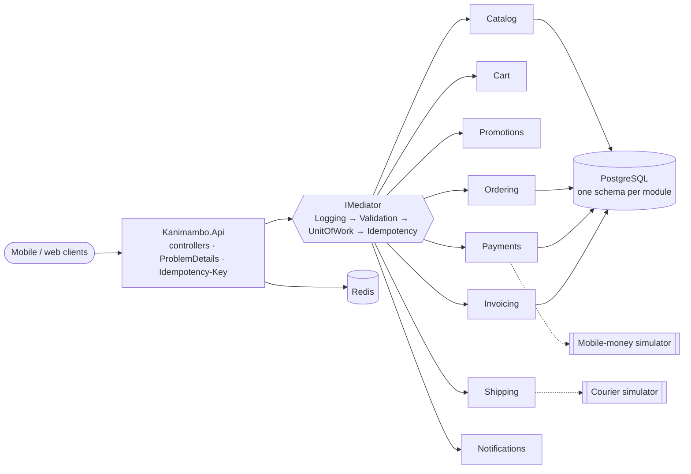

# Kanimambo Market

A marketplace backend for Mozambique, built as a **design patterns showcase in .NET 10**.
Each of the 26 patterns below solves a real business problem of the Mozambican market:
M-Pesa / e-Mola / mKesh mobile-money payments, IVA and ISPC tax regimes, monthly invoice
reporting to the Autoridade Tributária (e-Declaração), same-day delivery by *txopela* in Maputo,
and customers on unstable mobile networks.

> **Rule of the project:** no pattern is applied "just because". Every pattern document shows the
> naive solution, why it hurts, and when *not* to use the pattern.

*Kanimambo* means "thank you" in Changana.

## Status

**Phase 0 – Foundations** is complete: solution layout, Aspire orchestration, SharedKernel
(including the in-house **Mediator** and the **Specification** base), the API host with
ProblemDetails and `Idempotency-Key` support, architecture tests and CI.

## Design patterns index

Legend: ✅ implemented · 🟡 partially implemented · ⏳ planned

### Behavioral

| Pattern | Business problem | Module | Phase | Status | Docs |
|---|---|---|---|---|---|
| Chain of Responsibility | Order acceptance checks (NUIT, stock, delivery zone, anti-fraud, seller minimum) | Ordering | 3 | ⏳ | — |
| Command | Auditable, undoable back-office operations (bulk price change, suspend seller) | Catalog | 1 | ⏳ | — |
| Interpreter | Marketing-authored promotion rules evaluated at runtime | Promotions | 2 | ⏳ | — |
| Iterator | Streaming a slow, paginated wholesaler catalog as `IAsyncEnumerable` | Catalog | 1 | ⏳ | — |
| Mediator | In-process dispatch of commands/queries/notifications with ordered pipeline behaviors | SharedKernel | 0 | ✅ | [Mediator](docs/patterns/Mediator.md) |
| Memento | Cart snapshots for customers who lose connectivity; undo on B2B drafts | Cart | 2 | ⏳ | — |
| Observer | `OrderPaid` → invoice, SMS, seller notification, stock reservation (with outbox) | Transversal | 3 | ⏳ | — |
| State | Order lifecycle and mobile-money payment lifecycle | Ordering, Payments | 3–4 | ⏳ | — |
| Strategy | Shipping cost: same-day by zone, inter-provincial by weight, pickup point | Shipping | 5 | ⏳ | — |
| Template Method | Seller catalog imports (CSV, Excel, XML) with fixed steps and per-format hooks | Catalog | 1 | ⏳ | — |
| Visitor | Fiscal document tree → e-Declaração CSV/XLSX/XML, invoice PDF, IVA summary | Invoicing | 6 | ⏳ | — |

### Creational

| Pattern | Business problem | Module | Phase | Status | Docs |
|---|---|---|---|---|---|
| Abstract Factory | Coherent component families per tax regime (IVA normal vs ISPC) | Invoicing | 6 | ⏳ | — |
| Builder | Always-valid `Invoice` (NUITs, series, sequence, exemptions, MZN totals) | Invoicing | 6 | ⏳ | — |
| Factory Method | Payment processor by phone prefix (84/85 M-Pesa, 86/87 e-Mola, 82/83 mKesh) | Payments | 4 | ⏳ | — |
| Null Object | `GuestCustomer`, `NoPromotion`, `NoExchangeRate` remove null checks from checkout | Cart, Promotions | 2 | ⏳ | — |
| Object Pool | Reusing buffers for bulk PDF / QR / monthly AT file generation | Invoicing | 6 | ⏳ | — |
| Prototype | Weekly B2B reorders cloned from the previous order | Ordering | 3 | ⏳ | — |
| Singleton | Cached IVA/ISPC rate table and feature flags via DI lifetime | Transversal | 6 | ⏳ | — |

### Structural

| Pattern | Business problem | Module | Phase | Status | Docs |
|---|---|---|---|---|---|
| Adapter | M-Pesa / e-Mola / mKesh (and couriers) behind one gateway with unified errors | Payments, Shipping | 4–5 | ⏳ | — |
| Bridge | Message types × channels (SMS ≤160 chars, WhatsApp, e-mail) | Notifications | 7 | ⏳ | — |
| Composite | Bundles ("cabaz do mês") with recursive price, weight, stock and per-item IVA | Catalog | 1 | ⏳ | — |
| Decorator | Caching, retry, logging and metrics around repositories and HTTP clients | Infra | 4 | ⏳ | — |
| Facade | `CheckoutService` orchestrating cart, promotions, shipping, order, payment | Ordering | 3 | ⏳ | — |
| Flyweight | 100k product variants sharing interned immutable attributes | Catalog | 1 | ⏳ | — |
| Proxy | Cache + rate limit in front of a slow USD/ZAR → MZN exchange-rate API | Catalog | 1 | ⏳ | — |
| Specification | Composable catalog filters translated to SQL by EF Core | Catalog | 0–1 | 🟡 base in SharedKernel; EF/PostgreSQL proof in Phase 1 | [Specification](docs/patterns/Specification.md) |

## Architecture

A **modular monolith** with Clean Architecture inside each module. Modules communicate only through
public contracts and events, never through each other's `DbContext`
([ADR 0001](docs/adr/0001-modular-monolith.md)).



```
src/
  Kanimambo.AppHost/          .NET Aspire orchestration (PostgreSQL, Redis, API, simulators)
  Kanimambo.ServiceDefaults/  OpenTelemetry, health checks, service discovery, resilience
  Kanimambo.Api/              Host: controllers registration, ProblemDetails, idempotency middleware
  Kanimambo.SharedKernel/     Entity, AggregateRoot, DomainEvent, Result<T>, Money, Specification, Mediator
  Kanimambo.SharedKernel.Web/ ApiControllerBase (Result → ProblemDetails), shared HTTP attributes
  Modules/<Module>/           {Api, Application, Domain, Infrastructure} — added phase by phase
tests/
  Kanimambo.SharedKernel.UnitTests/
  Kanimambo.Api.IntegrationTests/   WebApplicationFactory + Testcontainers (PostgreSQL, Redis)
  Kanimambo.ArchitectureTests/      NetArchTest: layer and module isolation rules
docs/
  patterns/                   one document per pattern
  adr/                        architecture decision records
```

### Cross-cutting behavior

- **Errors.** Business failures travel as `Result`/`Result<T>` with a typed `Error`. They become
  RFC 9457 ProblemDetails with a stable `code` field (for example `ordering.below_seller_minimum`).
  Exceptions are kept for bugs and outages and return a generic 500 response that leaks no details.
- **Idempotency.** Every write endpoint accepts `Idempotency-Key`. A retry gets back the stored first
  response, marked `Idempotent-Replayed: true`. Reusing a key with a different payload returns 422.
  A retry that arrives while the first request is still running returns 409. 5xx responses are not
  stored, so the client can retry. Internal re-deliveries (outbox, payment callbacks) are
  de-duplicated by the Mediator's `IdempotencyBehavior`
  ([ADR 0003](docs/adr/0003-idempotency.md)).
- **Time.** `TimeProvider` is injected everywhere; nothing reads `DateTime.Now`.
- **Money.** `Money` is a `decimal` value object, rounded to 2 decimal places with
  `MidpointRounding.AwayFromZero`. Mixing currencies without an explicit conversion throws.

## Getting started

Prerequisites: [.NET SDK 10.0.402+](https://dotnet.microsoft.com/download) and Docker. The project
needs **no real credentials**: every external gateway runs as a local simulator.

```bash
# Run everything (PostgreSQL, Redis, API) with the Aspire dashboard
dotnet run --project src/Kanimambo.AppHost --launch-profile http

# API reference (Scalar) while the AppHost runs
open http://localhost:5080/scalar

# Build and test (integration tests start their own containers)
dotnet tool restore
dotnet build Kanimambo.slnx
dotnet test --solution Kanimambo.slnx
```

Tests run on Microsoft.Testing.Platform (xUnit v3). To collect coverage:

```bash
dotnet test --solution Kanimambo.slnx --coverage --coverage-output-format cobertura --results-directory TestResults
dotnet reportgenerator -reports:"TestResults/*.cobertura.xml" -targetdir:TestResults/report -reporttypes:Html
```

## Roadmap

| Phase | Scope |
|---|---|
| 0 ✅ | Foundations: solution, Aspire, SharedKernel, Mediator, Specification base, API host, CI, architecture tests |
| 1 | Catalog: Composite, Flyweight, Specification, Iterator, Template Method, Command, Proxy |
| 2 | Cart & Promotions: Memento, Null Object, Interpreter |
| 3 | Ordering & Checkout: State, Chain of Responsibility, Prototype, Facade, Observer + outbox |
| 4 | Payments: Factory Method, Adapter, payment State, mobile-money simulator, resilience Decorator |
| 5 | Shipping: Strategy, courier Adapter, simulator |
| 6 | Invoicing: Builder, Abstract Factory, Visitor, Object Pool + benchmarks, Singleton |
| 7 | Notifications: Bridge |
| 8 | Polish: C4 diagrams, end-to-end `.http` flow, badges, demo |
