# Abstract Factory

## Problem

Sellers on Kanimambo are taxed under one of two regimes:

- **IVA normal:** the seller charges IVA. Each invoice line extracts IVA at its category's rate (16%,
  5%, exempt with a legal reason), the documents use series `FT` / `NC`, and they say IVA is included.
- **ISPC** (Imposto Simplificado para Pequenos Contribuintes): small sellers pay a turnover tax and
  **do not charge IVA**. Every line must say it is not subject to IVA, the documents carry the ISPC
  notice, and they are numbered in their own series (`FS` / `NS` here).

A tax calculator, a document formatter and a numbering series only make sense **together**. An ISPC
invoice with IVA lines, or an IVA invoice numbered in the ISPC series, is a fiscal error that is
hard to undo.

## Naive solution

```csharp
var calculator = seller.Regime == "ISPC" ? new IspcCalculator() : new IvaCalculator(rates);
var series     = seller.IsSmall ? "FS" : "FT";   // a different condition, written somewhere else
var notice     = seller.Regime == "ISPC" ? IspcNotice : null;
// Nothing stops the three from disagreeing, and every new document type repeats the conditions.
```

## Solution

`IFiscalRegimeFactory` creates one family: `CreateTaxCalculator()`, `CreateFormatter()` and
`CreateSeries()`. There are two concrete factories:

- `IvaNormalFactory` produces `IvaTaxCalculator`, which extracts IVA using the rate table, plus a
  formatter and a series configured for IVA normal.
- `IspcFactory` produces `IspcTaxCalculator` (no IVA, "Não sujeito a IVA — regime do ISPC" on every
  line), plus a formatter and a series configured for ISPC.

**Mixing regimes is impossible, not just discouraged:**

- **Every component knows its regime.** Each implements `IRegimeComponent.Regime`.
- **Components only travel as a kit.** `FiscalRegimeKit` bundles the three, and its constructor
  throws if their regimes differ. `FiscalRegimeKit.From(factory)` is the normal way to get one.
- **Documents are built from a kit.** `InvoiceBuilder.For(kit)` and `CreditNote.ForRefund(invoice, kit, …)`
  take a kit, never loose components, and a credit note refuses a kit of a different regime than its
  invoice.
- **The kit is picked by regime.** `FiscalRegimeFactories` looks it up from the issuer's regime (a
  dictionary, no `switch`), so the issuer's profile decides the whole family.

```mermaid
classDiagram
    class IFiscalRegimeFactory {
        <<interface>>
        +Regime
        +CreateTaxCalculator() ITaxCalculator
        +CreateFormatter() IDocumentFormatter
        +CreateSeries() IDocumentSeries
    }
    IFiscalRegimeFactory <|.. IvaNormalFactory
    IFiscalRegimeFactory <|.. IspcFactory
    IvaNormalFactory ..> IvaTaxCalculator : creates
    IspcFactory ..> IspcTaxCalculator : creates
    IvaNormalFactory ..> RegimeFormatter : IVA normal options
    IspcFactory ..> RegimeFormatter : ISPC options
    class FiscalRegimeKit {
        +Regime
        +Calculator
        +Formatter
        +Series
        ctor rejects mixed regimes
    }
    FiscalRegimeKit o-- ITaxCalculator
    FiscalRegimeKit o-- IDocumentFormatter
    FiscalRegimeKit o-- IDocumentSeries
    FiscalRegimeFactories --> IFiscalRegimeFactory : by regime
    InvoiceBuilder --> FiscalRegimeKit
```



The series letters, the legal notices and the "not subject" reason come from configuration
(`Invoicing:IvaNormal`, `Invoicing:Ispc`). The rates come from the rate table
([Singleton](Singleton.md)).

## Where in the code

- Products and the kit: [FiscalRegimeKit.cs](../../src/Modules/Invoicing/Kanimambo.Invoicing.Domain/FiscalRegimeKit.cs)
- Factories, calculators and the registry: [FiscalRegimes.cs](../../src/Modules/Invoicing/Kanimambo.Invoicing.Application/Regimes/FiscalRegimes.cs)
- Registration: [InvoicingInfrastructureExtensions.cs](../../src/Modules/Invoicing/Kanimambo.Invoicing.Infrastructure/InvoicingInfrastructureExtensions.cs)
- A seller's regime: `TaxpayerProfile`, registered with `PUT /api/invoicing/taxpayers/{sellerId}`

## Tests

- [FiscalRegimeFactoryTests](../../tests/Kanimambo.Invoicing.UnitTests/AbstractFactory/FiscalRegimeFactoryTests.cs):
  - the same sale under ISPC charges 0 IVA, prints the reason on every line and uses `FS`;
  - every product of each factory reports that factory's regime;
  - **a kit refuses components of different regimes**;
  - a credit note uses its invoice's regime (`NS` for ISPC) and refuses another kit;
  - the registry hands out whole kits.
- [InvoicingTests](../../tests/Kanimambo.Invoicing.IntegrationTests/InvoicingTests.cs): one order
  with an IVA-normal seller and an ISPC seller gets an `FT` invoice with IVA and an `FS` invoice
  without IVA, and the invoices add up to the order total.

## Trade-offs & when NOT to use

- **No families, no factory.** If only one component varied (say, the calculator), a Strategy would be
  enough. The factory pays off because three components must vary *together*.
- **New products touch every factory.** Adding a product to the family (for example a QR-code
  generator per regime) means changing the interface and every factory.
- **Two near-identical classes are configured, not copied.** `RegimeFormatter` and `RegimeSeries` are
  shared, with each factory passing its own options. That keeps duplication low, at the cost of
  formatting differences living in configuration rather than in types.
