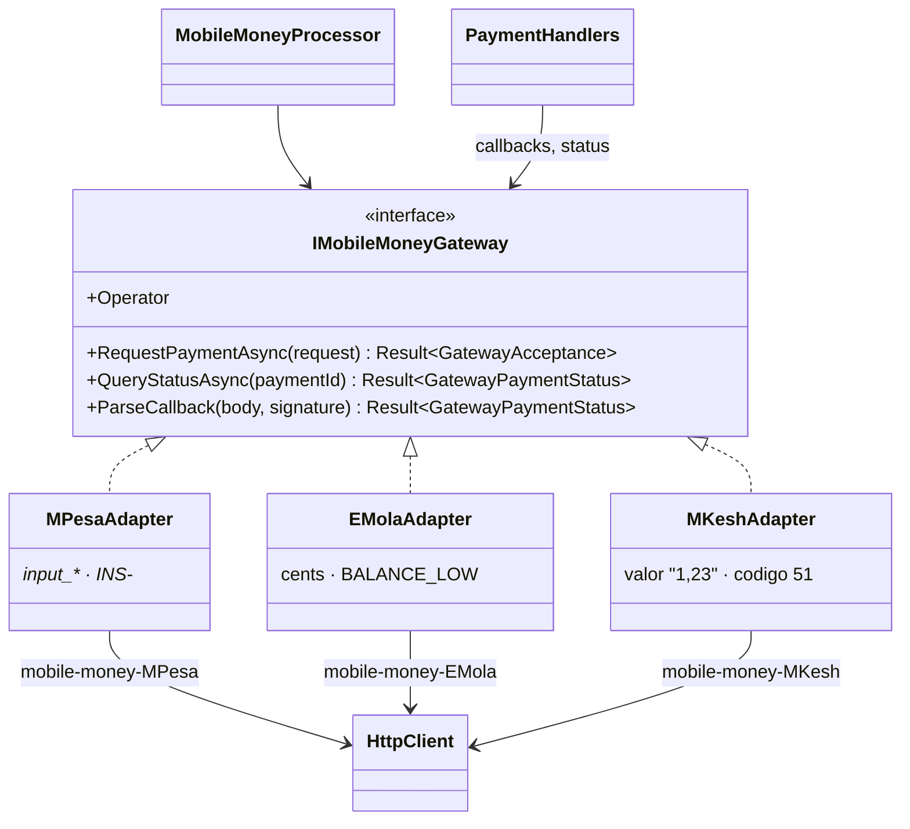

# Adapter

## Problem

The three mobile-money operators each speak a different API: different field names, error codes,
amount formats, ways of querying status, and callback formats. The rest of the system wants
one question ("charge this phone this amount, call me back here") and one vocabulary of outcomes
(`InsufficientBalance`, `DuplicateTransaction`, `InvalidNumber`, `Timeout`…). Support staff
still need each operator's native code when a customer calls.

> The formats below are the ones implemented by **our local simulator**
> (`Kanimambo.Simulators.MobileMoney`). They are deliberately different from each other to show what
> an adapter absorbs. They are **not** the official APIs of Vodacom, Movitel or Tmcel; a real adapter
> needs each operator's sandbox credentials and documentation.

| | M-Pesa (simulated) | e-Mola (simulated) | mKesh (simulated) |
|---|---|---|---|
| Request | `POST mpesa/c2b`, `input_*` fields | `POST emola/payments`, camelCase JSON | `POST mkesh/v1/cobrancas`, Portuguese fields |
| Amount | `"1234.50"` (string) | `123450` (cents) | `"1234,50"` (decimal comma) |
| Result | `output_ResponseCode`: `INS-0`, `INS-5`, `INS-6`, `INS-10` | `status`: `PENDING` / `REJECTED` + `errorCode` | numeric `codigo`: 0, 94, 51, 14 |
| Status | `output_ResponseTransactionStatus` | `SUCCESS` / `FAILED` / `PENDING` | `CONCLUIDA` / `FALHADA` / `PENDENTE` |

Callbacks from all three carry `X-Signature: sha256=<HMAC of the body>`.

## Naive solution

```csharp
if (op == "MPesa") { var r = await mpesa.C2B(...); if (r.output_ResponseCode == "INS-6") ... }
else if (op == "EMola") { var r = await emola.Pay(...); if (r.errorCode == "BALANCE_LOW") ... }
// Operator codes leak into the domain, error handling is copied per operator,
// and the callback endpoint parses three formats inline.
```

## Solution

`IMobileMoneyGateway` is the **target** interface, defined in Application, in the system's own
terms:

- `RequestPaymentAsync(MobileMoneyRequest)` returns `GatewayAcceptance` or a `GatewayError`;
- `QueryStatusAsync(paymentId)` returns a `GatewayPaymentStatus`;
- `ParseCallback(body, signature)` verifies the HMAC and translates the payload.

Each operator has an **adapter** in Infrastructure: `MPesaAdapter`, `EMolaAdapter` and
`MKeshAdapter`. Each one:

- serialises the request in its operator's format;
- maps native codes to `PaymentFailureReason`, keeping the native code in `GatewayError.NativeCode`
  and on the payment;
- turns 5xx responses, timeouts and connection failures into `GatewayUnavailable` / `Timeout`, both
  marked `IsTransient`, so the retry decorator knows what is safe to repeat.

The shared HTTP and signature plumbing is in `GatewayHttp` and `CallbackSignature`. The translation
of each format stays inside its own adapter.



The callback endpoint (`POST /api/payments/callbacks/{operator}`) is anonymous and generic. It passes
the raw body and signature to the operator's adapter, so a forged or tampered callback is rejected
with `401 payments.invalid_signature` before anything else happens.

## Where in the code

- Target: [MobileMoneyGateway.cs](../../src/Modules/Payments/Kanimambo.Payments.Application/Gateways/MobileMoneyGateway.cs)
- Adapters: [OperatorAdapters.cs](../../src/Modules/Payments/Kanimambo.Payments.Infrastructure/Gateways/Adapters/OperatorAdapters.cs),
  [GatewayHttp.cs](../../src/Modules/Payments/Kanimambo.Payments.Infrastructure/Gateways/Adapters/GatewayHttp.cs)
- Simulator: [OperatorControllers.cs](../../src/Simulators/Kanimambo.Simulators.MobileMoney/OperatorControllers.cs)
- Callback endpoint: [PaymentsController.cs](../../src/Modules/Payments/Kanimambo.Payments.Api/Controllers/PaymentsController.cs)
- Phase 5 adds courier adapters the same way.

## Tests

- [OperatorAdapterTests](../../tests/Kanimambo.Payments.UnitTests/Adapter/OperatorAdapterTests.cs),
  against a stub HTTP handler:
  - ten native refusal codes map to the shared reasons with the native code kept;
  - accepted requests return the operator's transaction id;
  - each operator receives the amount in its own format;
  - 5xx and connection errors are transient;
  - status queries and signed callbacks are translated;
  - missing, forged and tampered signatures are rejected.
- [MobileMoneyPaymentTests](../../tests/Kanimambo.Payments.IntegrationTests/MobileMoneyPaymentTests.cs):
  the three operators end to end through the simulator, including native codes on failed payments
  and forged callbacks returning 401.

## Trade-offs & when NOT to use

- **Shared vocabulary loses detail.** The native code is kept for support, but logic should never
  branch on it. If it starts to, the shared enum is missing a case.
- **One adapter per operator is the right size here.** A generic, configuration-driven "JSON mapping"
  adapter looks attractive but turns code into untestable configuration.
- **If you control both sides, you don't need it.** Make them agree on one contract instead.
