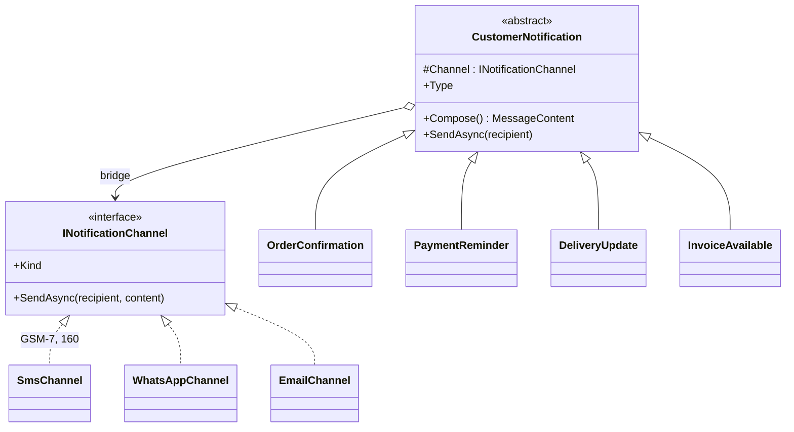
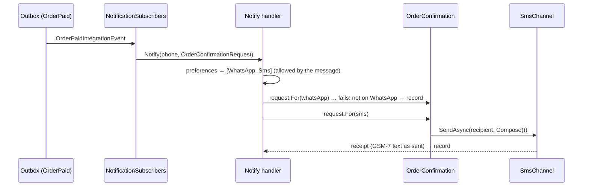

# Bridge

## Problem

Customers must hear about their orders: the payment was received, a payment failed, the parcel is
on its way or was delivered, an invoice is ready. In Mozambique **SMS is the main channel**, because
not everyone has a smartphone. WhatsApp and e-mail come next.

Messages and channels change for different reasons:

- **Marketing changes the messages** and adds new kinds (a payment reminder, a review request).
- **Operations changes the channels** (a new SMS aggregator, WhatsApp Business, USSD one day).
- **Each channel has hard rules of its own:**
  - an SMS is 160 characters of the GSM-7 alphabet. One `ã` or `ç` switches the whole message to
    UCS-2, and the limit drops to 70 characters;
  - WhatsApp allows formatting and long text;
  - e-mail needs a subject and HTML.

## Naive solution

```csharp
class OrderConfirmationSms { … }      class OrderConfirmationWhatsApp { … }      class OrderConfirmationEmail { … }
class PaymentReminderSms { … }        class PaymentReminderWhatsApp { … }        class PaymentReminderEmail { … }
class DeliveryUpdateSms { … }         class DeliveryUpdateWhatsApp { … }         class DeliveryUpdateEmail { … }
class InvoiceAvailableSms { … }       class InvoiceAvailableWhatsApp { … }       class InvoiceAvailableEmail { … }
// 4 × 3 = 12 classes. A new channel adds 4, a new message adds 3, and the 160-character rule is copied 4 times.
```

## Solution

Two hierarchies, joined by a reference.

- **Abstraction: `CustomerNotification`.** It decides *what* to say. It composes a `MessageContent`:
  subject, headline (the essentials, all an SMS can carry), details, and a link. It holds the
  `INotificationChannel` that will say it. There are four refined abstractions: `OrderConfirmation`,
  `PaymentReminder`, `DeliveryUpdate` and `InvoiceAvailable`.
- **Implementor: `INotificationChannel`.** It decides *how* the message travels. There are three
  implementations:
  - `SmsChannel` keeps the headline only, converts it to GSM-7 (`ação` → `acao`, while keeping `é`
    and `Ç`, which GSM-7 has), and fits 160 characters. It cuts at a word with `...`, and adds the
    link only if it still fits;
  - `WhatsAppChannel` sends a bold subject, the headline, the details and the link;
  - `EmailChannel` sends a subject line and an HTML page, with the content HTML-encoded.

**The bridge is assembled at send time,** from the customer's preferences:

- `ContactPreferences` are the channels in order; without preferences, `Notifications:DefaultChannels`
  applies, which is SMS.
- Each message may restrict its channels. Invoices never go by SMS, because one order can produce
  several documents.
- The first channel that delivers wins. A channel that refuses ("not on WhatsApp") or is down (SMS
  gateway 503) is recorded, and the next one is tried at once.
- When only temporary failures happened, the command fails and the outbox retries later.





4 messages + 3 channels = **7 classes instead of 12**. A new channel (USSD, push) is one class and one
DI line. A new message is one class plus a request record. Neither touches the other side.

## Where in the code

- Abstraction, implementor interface and messages: [Bridge.cs](../../src/Modules/Notifications/Kanimambo.Notifications.Application/Messages/Bridge.cs)
- Requests, subscribers and the dispatcher (channel choice and fallback):
  [NotificationRequests.cs](../../src/Modules/Notifications/Kanimambo.Notifications.Application/NotificationRequests.cs)
- Channels, GSM-7 conversion and gateway calls: [Channels.cs](../../src/Modules/Notifications/Kanimambo.Notifications.Infrastructure/Channels/Channels.cs)
- Preferences and the delivery log: [Notifications.cs](../../src/Modules/Notifications/Kanimambo.Notifications.Domain/Notifications.cs)
- Simulator (enforces GSM-7 and 160 characters): [MessagingSimulator.cs](../../src/Simulators/Kanimambo.Simulators.Messaging/MessagingSimulator.cs)

## Tests

- [BridgeTests](../../tests/Kanimambo.Notifications.UnitTests/Bridge/BridgeTests.cs):
  - **all 12 message × channel combinations** send, and each renders within its channel's rules
    (every SMS is GSM-7 and at most 160 characters);
  - the SMS text is exact;
  - long headlines are cut at a word;
  - GSM-7 conversion (an emoji becomes one `?`), and extension characters count twice;
  - e-mail is HTML-encoded;
  - amounts read `4 583,10 MZN`.
- [DispatchTests](../../tests/Kanimambo.Notifications.UnitTests/DispatchTests.cs):
  - SMS by default;
  - preference order with fallback, every attempt recorded;
  - invoices never by SMS;
  - e-mail only with an address;
  - temporary outages are retried, permanent refusals are not;
  - preferences are validated.
- [NotificationTests](../../tests/Kanimambo.Notifications.IntegrationTests/NotificationTests.cs), through the
  outbox and the simulator:
  - payment confirmation by SMS;
  - payment reminder with the reason;
  - e-mail preferences receive the confirmation and the invoice;
  - without WhatsApp or e-mail, invoices are not sent;
  - fallback in both directions (not on WhatsApp → SMS; SMS gateway down → WhatsApp);
  - delivery progress messages;
  - preferences belong to the account that registered them;
  - the gateway rejects accents and 161-character SMS.

## Trade-offs & when NOT to use

- **One dimension doesn't need it.** If channels never varied, or every message were the same text on
  every channel, plain inheritance or a template would do.
- **`MessageContent` is the contract between the two sides.** A channel that needs something new (an
  attachment, a button) means extending it, which every message then has to consider.
- **Some combinations are disallowed by policy, not by the type system** (an invoice by SMS). The
  bridge makes every combination *possible*; `AllowedChannels` says which ones *make sense*.
