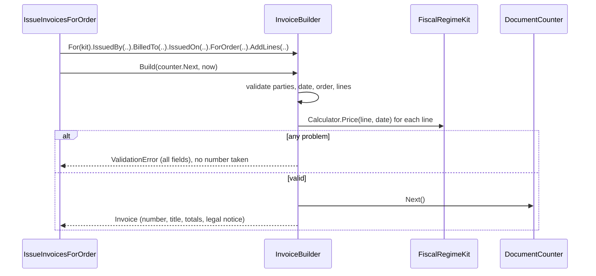

# Builder

## Problem

A Mozambican invoice (*fatura*) has many parts, and they must be valid **together**:

- **Issuer:** its 9-digit NUIT and legal name, and the fiscal regime it is taxed under.
- **Buyer:** a business customer must be invoiced with its NUIT; a final consumer may have none.
- **Number:** the issuer's series for that regime (FT for IVA normal, FS for ISPC), and the **next
  sequential number** of that series and year, with no gaps.
- **Issue date:** it decides which IVA rate is in force (17% until 2022, 16% since 2023).
- **Lines:** each one priced by the regime's rules. Prices include IVA, so IVA is extracted.
  Discounts lower the taxable amount, and every untaxed line must print its legal reason.
- **Totals:** in MZN, equal to the sum of the lines.

If any part is missing or wrong, the document must not exist at all. An invalid invoice that was
"almost issued" has already consumed a number in a series that must stay gapless.

## Naive solution

```csharp
var invoice = new Invoice
{
    Number = await counter.NextAsync(),   // number taken first…
    IssuerNuit = seller.Nuit,             // …then maybe "12345", or null
    Lines = lines,                        // IVA computed by whoever wrote this call site
};
if (!invoice.IsValid()) { /* the number is gone, the object exists, someone may save it anyway */ }
```

## Solution

`InvoiceBuilder` collects the parts step by step, and `Build` validates everything **at once**.

```csharp
var invoice = InvoiceBuilder.For(kit)               // the regime's calculator, formatter and series (Abstract Factory)
    .IssuedBy(profile.AsIssuer)
    .BilledTo(buyer, nuitRequired: isBusiness)
    .IssuedOn(MozambiqueTime.Today(clock))
    .ForOrder(orderId, orderNumber, sellerId, customerPhone)
    .AddLines(lines)
    .Build(counter.Next, now);                      // Result<Invoice>
```

**What `Build` does:**

- **Validates.** It checks the NUITs, the buyer NUIT when required, the issue date, the order, the
  quantities and amounts, and that the total is positive.
- **Prices.** Every line is priced with the kit's tax calculator. Unknown tax categories and untaxed
  lines without a legal reason are errors.
- **Reports everything at once.** All problems come back together as one `ValidationError` (`issuer.nuit`,
  `buyer.nuit`, `lines[2].taxCategory`…), not just the first.
- **Takes a number last.** Only when everything is valid does it call `nextNumber`. A rejected invoice
  therefore never consumes a number. The counter row is tracked by the same unit of work as the invoice,
  so number and document are saved together or not at all.
- **Is the only way to make an invoice.** The `Invoice` constructor is internal, so invalid invoices
  never exist in memory.



## Where in the code

- [InvoiceBuilder.cs](../../src/Modules/Invoicing/Kanimambo.Invoicing.Domain/InvoiceBuilder.cs)
- [FiscalDocuments.cs](../../src/Modules/Invoicing/Kanimambo.Invoicing.Domain/FiscalDocuments.cs) (`Invoice`,
  whose constructor is internal; `CreditNote.ForRefund` also takes its number last)
- Used by `TryIssueAsync` in
  [InvoicingRequests.cs](../../src/Modules/Invoicing/Kanimambo.Invoicing.Application/InvoicingRequests.cs)
- `DocumentCounter` in [Taxpayers.cs](../../src/Modules/Invoicing/Kanimambo.Invoicing.Domain/Taxpayers.cs)

## Tests

- [InvoiceBuilderTests](../../tests/Kanimambo.Invoicing.UnitTests/Builder/InvoiceBuilderTests.cs):
  - IVA is extracted correctly: 1 000 → 862.07 + 137.93;
  - a discount lowers the taxable amount;
  - five problems are reported at once;
  - a business buyer needs its NUIT;
  - bad quantities and amounts are refused;
  - unknown categories are refused, never charged at 0%;
  - an untaxed line needs its legal reason;
  - **no number is taken for an invalid invoice**;
  - a 2022 date applies 17%.
- [InvoicingTests](../../tests/Kanimambo.Invoicing.IntegrationTests/InvoicingTests.cs):
  - numbers run FT 2026/000001, 000002, 000003 per issuer;
  - a business customer's NUIT is printed on the invoice.

## Trade-offs & when NOT to use

- **Small objects don't need it.** A record with a validating factory method is simpler.
- **Validation can drift.** The builder holds a second copy of the invariants the type implies. Keeping
  the constructor internal is what stops anyone from bypassing it.
- **Gapless numbering has a cost.** It serialises invoice issuing per issuer and series: two concurrent
  invoices for the same seller conflict on the counter row, and one is retried by the outbox. At
  marketplace volumes that is fine. At very high volumes, series per point of sale would be the next
  step.
