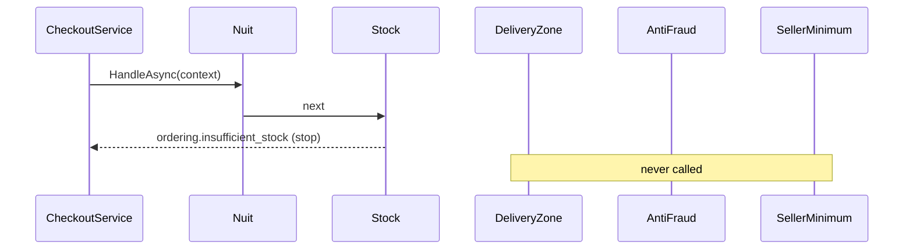

# Chain of Responsibility

## Problem

Before an order is accepted, several independent checks must pass:

- a business customer gave a **NUIT** (9 digits);
- there is **stock** for every line;
- every seller **delivers to the city**;
- the **phone number** is within the daily anti-fraud limits;
- each seller's **minimum order** is met (wholesalers set one).

Each check fails with its own typed error. Checks are added, removed and reordered as the business learns
(for example, run the cheap checks first, or put anti-fraud first during an attack), so the order must
be configuration, not code.

## Naive solution

```csharp
if (customer.IsBusiness && !IsValidNuit(nuit)) return Error(...);
foreach (var line in lines) if (line.Quantity > stock[line.Id]) return Error(...);
if (!sellers.All(s => s.DeliversTo(city))) return Error(...);
if (await CountOrdersByPhone(phone) >= 5) return Error(...);
// …one method that grows forever, hard to test in isolation, order fixed in code.
```

## Solution

Each check is an `OrderAcceptanceHandler`. It either fails with a typed `Error`, which **stops the
chain**, or passes the order on to the next handler. Handlers don't know each other or their position.

The chain is composed **in DI**, and registration order is execution order:

```csharp
services.AddOrderAcceptanceChain(chain => chain
    .Then<BusinessCustomersNeedValidNuit>()
    .Then<StockMustBeAvailable>()
    .Then<SellersMustDeliverToTheCity>()
    .Then<PhoneMustBeWithinFraudLimits>()
    .Then<SellerMinimumsMustBeMet>());
```

`AddOrderingApplication(acceptanceChain: …)` accepts a different composition. Handlers are scoped
services, so they can depend on repositories (anti-fraud queries recent orders by phone) and
configuration (`Ordering:MaxOrdersPerPhonePerDay`).



The NUIT check validates the format only (9 digits). The official check-digit rule isn't published in a
form we can rely on, so it is deliberately not invented.

## Where in the code

- [OrderAcceptanceChain.cs](../../src/Modules/Ordering/Kanimambo.Ordering.Application/Acceptance/OrderAcceptanceChain.cs)
  (base, chain, builder, DI)
- [AcceptanceChecks.cs](../../src/Modules/Ordering/Kanimambo.Ordering.Application/Acceptance/AcceptanceChecks.cs)
  (the five checks)
- Composition:
  [OrderingApplicationExtensions.cs](../../src/Modules/Ordering/Kanimambo.Ordering.Application/OrderingApplicationExtensions.cs)

## Tests

- [AcceptanceChainTests](../../tests/Kanimambo.Ordering.UnitTests/ChainOfResponsibility/AcceptanceChainTests.cs) cover:
  - **the chain stops at the first failure**, so later handlers are never called;
  - the order follows registration;
  - the production chain composition;
  - each check's rule, including the anti-fraud boundary at exactly the limit.
- [CheckoutTests](../../tests/Kanimambo.Ordering.IntegrationTests/CheckoutTests.cs) cover the checks
  over HTTP, against PostgreSQL:
  - below the seller minimum;
  - a city not covered;
  - stock that dropped after the item was added to the cart;
  - a B2B customer without a NUIT;
  - the sixth order of the day from one phone.

## Trade-offs & when NOT to use

- **Only the first error is reported.** For forms where the user wants every problem at once, run all
  validators and aggregate instead (that is what the Mediator's `ValidationBehavior` does).
- **The order is implicit in configuration.** A test that pins the production chain keeps it visible.
- **Not for two fixed checks that never change.** Two `if` statements are clearer.
