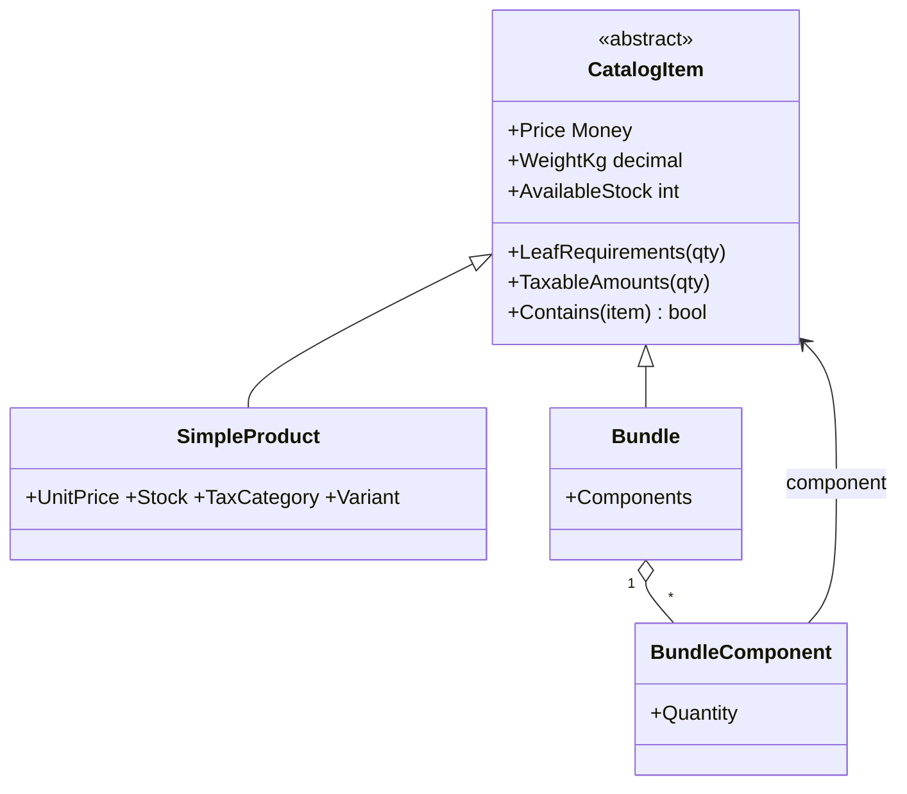

# Composite

## Problem

Mozambican shops sell **cabazes**: kits such as the *Cabaz do Mês* (rice, cooking oil, sugar, maize
flour), and sometimes kits made of other kits (*Cabaz Família* = *Cabaz do Mês* + beans + extra
sugar). Checkout, shipping and invoicing need the same answers for a kit as for a single product:

- **Price.** The sum of the components.
- **Weight.** Shipping is priced by weight between provinces.
- **Available stock.** You can't sell a basket if one of its ingredients is out of stock.
- **IVA.** Calculated **per component**, because rice can be exempt while oil is taxed at 16%.

## Naive solution

```csharp
decimal PriceOf(Product p) =>
    p.IsKit
        ? p.KitItems.Sum(i => (i.Product.IsKit ? PriceOf(i.Product) : i.Product.Price) * i.Quantity)
        : p.Price;
// ...and the same branching again for weight, stock, IVA, in checkout, shipping and invoicing.
```

Why it hurts:

- every consumer re-implements the recursion, with its own `IsKit` branches;
- nesting depth is often hard-coded ("kits can't contain kits");
- the stock rule is subtle and easy to get wrong.

A naive recursive minimum treats a product reached through two sub-bundles as if it were needed once.
For *Cabaz Família* that answers 40 when the correct figure is 30, so the shop **oversells**.

## Solution

`CatalogItem` is the component. `SimpleProduct` is the leaf, and `Bundle` is the composite: it holds
`(CatalogItem, quantity)` pairs and can contain other bundles. Clients call `Price`, `WeightKg`,
`AvailableStock` and `TaxableAmounts()` without knowing which kind of item they have.



Design points:

- **Stock is derived by flattening.** `LeafRequirements` flattens the tree first, summing the
  quantity of each leaf product needed per bundle, and then takes `min(stock / quantity)`.
- **Invariants on composition.** All components must belong to the same seller and be priced in the
  same currency, a bundle can't contain itself at any depth (`Contains` is recursive), and adding a
  component twice merges the quantities.
- **IVA uses configured rates.** `TaxableAmounts` yields the net amount per leaf and tax category, and
  `IvaBreakdown` groups them and applies the configured rate of each category.
- **Same rules for search.** The `catalog_entries` view repeats the same rules in SQL with a recursive
  CTE, so search filters see the same price, weight and stock (see [Specification](Specification.md)).
- **Loading the tree.** `CatalogItemRepository.GetTreeAsync` loads the tree level by level, and EF's
  identity map wires the components together, so any depth works.

## Where in the code

- [CatalogItem.cs](../../src/Modules/Catalog/Kanimambo.Catalog.Domain/Products/CatalogItem.cs),
  [SimpleProduct.cs](../../src/Modules/Catalog/Kanimambo.Catalog.Domain/Products/SimpleProduct.cs),
  [Bundle.cs](../../src/Modules/Catalog/Kanimambo.Catalog.Domain/Products/Bundle.cs)
- IVA per component:
  [IvaBreakdown.cs](../../src/Modules/Catalog/Kanimambo.Catalog.Application/Pricing/IvaBreakdown.cs)
- Uniform use:
  [GetProductDetails.cs](../../src/Modules/Catalog/Kanimambo.Catalog.Application/Products/GetProductDetails.cs)
- Tree loading:
  [Repositories.cs](../../src/Modules/Catalog/Kanimambo.Catalog.Infrastructure/Persistence/Repositories.cs);
  SQL twin:
  [CatalogEntriesViewSql.cs](../../src/Modules/Catalog/Kanimambo.Catalog.Infrastructure/Persistence/CatalogEntriesViewSql.cs)

## Tests

- [BundleCompositeTests](../../tests/Kanimambo.Catalog.UnitTests/Composite/BundleCompositeTests.cs) cover:
  - single product and bundle answering the same calls;
  - the stock minimum;
  - a nested bundle with a shared leaf (30, not 40);
  - any depth;
  - IVA per category;
  - cycles;
  - mixed sellers and currencies.
- [SpecificationInPostgresTests](../../tests/Kanimambo.Catalog.IntegrationTests/SpecificationInPostgresTests.cs)
  prove that the database view and the domain composite agree on the seeded bundles.
- [CatalogApiTests](../../tests/Kanimambo.Catalog.IntegrationTests/CatalogApiTests.cs) cover the
  bundle details endpoint (tree, stock and IVA) and bundle creation.

## Trade-offs & when NOT to use

- **Recursion cost.** Every call walks the tree. That's cheap for kits of a few items, but a catalog
  page of thousands of bundles should read the pre-computed view instead of loading trees.
- **Two implementations to keep in sync.** The domain and the SQL view must stay equivalent; the
  integration test is what guards that.
- **Not for single-level kits.** If kits never nest and are sold at a fixed price with their own stock,
  a plain product with a "contents" description is simpler. Choose Composite only when figures must be
  *derived* from the components.
- **Discounts belong elsewhere.** Bundle discounts are not modelled here; Promotions (Phase 2) applies
  them, which keeps the composite's arithmetic exact.
