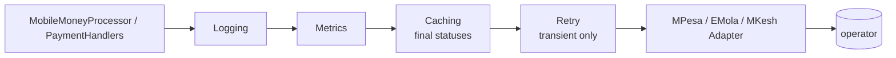

# Decorator

## Problem

Calls to mobile-money operators fail in ordinary ways: 5xx responses at peak hours, timeouts on a
congested network, a connection reset. Some failures must be **retried**, and others must **never**
be retried. Retrying "insufficient balance" just annoys the customer; retrying a request that did reach
the operator can create a duplicate charge.

Operations also needs **logs** and **metrics** per operator: which one is failing, and how slowly.
And operators rate-limit **status queries**, while a settled transaction never changes.

These are four concerns, and three adapters. Writing them inside each adapter would mean 12 copies.

## Naive solution

```csharp
public async Task<Result<GatewayAcceptance>> RequestPaymentAsync(...)
{
    var sw = Stopwatch.StartNew();
    for (var i = 0; i < 3; i++)
    {
        try { var r = await Post(...); logger.Log(...); meter.Add(...); return Map(r); }
        catch (HttpRequestException) { await Task.Delay(300 * (1 << i)); }   // retries INS-6 too? duplicates?
    }
    ...
}   // …copied into MPesaAdapter, EMolaAdapter and MKeshAdapter, and into every status query.
```

## Solution

Each concern is a **decorator**: a class that implements `IMobileMoneyGateway`, wraps another
`IMobileMoneyGateway`, and adds one behaviour. `MobileMoneyGatewayDecorator` forwards everything by
default, so each decorator overrides only what it cares about.

| Decorator | Adds |
|---|---|
| `LoggingGatewayDecorator` | one structured log line per call: operator, operation, payment id, outcome (`ok` or the error code), duration |
| `MetricsGatewayDecorator` | OpenTelemetry counter and histogram (`kanimambo.payments.gateway.*`, meter `Kanimambo.Payments`) tagged with operator, operation and outcome |
| `CachingGatewayDecorator` | caches **final** statuses (confirmed or failed) in Redis for a day; pending statuses are never cached |
| `RetryingGatewayDecorator` | Polly v8 exponential backoff for **transient** `GatewayError`s only (`GatewayUnavailable`, `Timeout`) |

**Duplicates after a retry.** The payment reference sent to the operator is our payment id. If the
first attempt reached the operator but its answer was lost, the retry comes back as
`DuplicateTransaction`. The retry decorator recognises that case: a duplicate after more than one
attempt triggers a status query. If the original transaction exists, its id is returned as a normal
acceptance, instead of failing a payment the customer is about to confirm.

The chain is composed in one place, outermost first, where the order is visible:

```csharp
gateway = new RetryingGatewayDecorator(adapter, options.GatewayMaxRetries, options.GatewayRetryBaseDelay);
gateway = new CachingGatewayDecorator(gateway, cache);
gateway = new MetricsGatewayDecorator(gateway, metrics);
gateway = new LoggingGatewayDecorator(gateway, logger);
```



**Why this order:**

- Logging and metrics sit outside, so they record **one** call as the caller saw it, including the
  total time spent retrying.
- Caching sits outside retry, so a cache hit costs no retries.
- Retry sits closest to the adapter, so it repeats only the HTTP exchange.

## Where in the code

- [GatewayDecorators.cs](../../src/Modules/Payments/Kanimambo.Payments.Infrastructure/Gateways/Decorators/GatewayDecorators.cs)
- Composition: `AddGateway` in
  [PaymentsInfrastructureExtensions.cs](../../src/Modules/Payments/Kanimambo.Payments.Infrastructure/PaymentsInfrastructureExtensions.cs)
  (one keyed singleton per operator)
- Settings: `Payments:GatewayMaxRetries`, `Payments:GatewayRetryBaseDelay`
- The meter is exported through ServiceDefaults (`Kanimambo.*`) and shows up in the Aspire dashboard.

## Tests

[GatewayDecoratorTests](../../tests/Kanimambo.Payments.UnitTests/Decorator/GatewayDecoratorTests.cs)
test each decorator in isolation around a scripted fake operator:

- retry recovers after two transient failures;
- retry gives up after the configured attempts;
- a business answer is never retried;
- a duplicate after a retry recovers the first transaction;
- a duplicate on the first attempt stays a duplicate;
- status queries are retried;
- caching stores final statuses only;
- metrics carry operator, operation and outcome tags (`MeterListener`);
- logging passes the result through untouched;
- the chain preserves `Operator` and forwards callbacks.

[MobileMoneyPaymentTests](../../tests/Kanimambo.Payments.IntegrationTests/MobileMoneyPaymentTests.cs)
run the composed chain:

- an operator outage (simulator phone suffix `0006`) costs exactly three requests, then fails the
  payment as `GatewayUnavailable`;
- removing the HTTP-resilience opt-out makes this test fail (checked).

## Trade-offs & when NOT to use

- **Order matters, and it is invisible at call sites.** Swapping caching and retry changes the
  behaviour. Keep the composition in one place, and test it when it changes.
- **Many small classes.** For one concern on one class, a few lines inline are clearer.
- **Don't stack two retry layers.** ServiceDefaults gives every `HttpClient` the standard resilience
  handler, which would also retry payment POSTs. The operator clients opt out
  (`RemoveAllResilienceHandlers()`) and get a plain `Payments:GatewayTimeout`.
  - Without the opt-out, three decorator attempts would become up to twelve operator calls.
  - An integration test guards this: an operator outage must cost exactly 1 + `GatewayMaxRetries`
    requests.
- **Generic HTTP concerns belong lower down.** This decorator exists because the decision is
  *business-aware*: which `GatewayError`s are transient, and how to recover a duplicate. If the
  decision were purely HTTP-level, a `DelegatingHandler` or the standard resilience handler would be
  the right tool.
