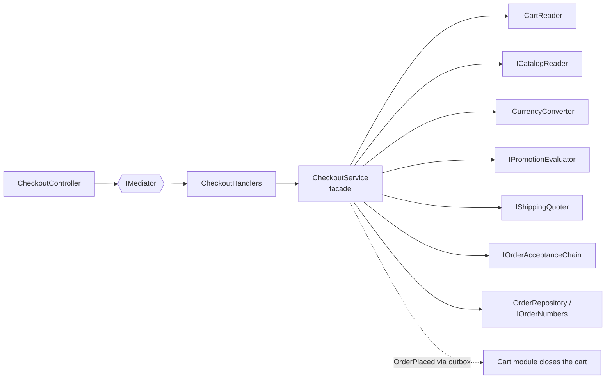

# Facade

## Problem

Turning a cart into an order touches almost every subsystem in the marketplace:

- **Cart:** read the lines, check access, and refuse a cart that was already checked out.
- **Catalog:** current prices and stock, plus the sellers (delivery cities, minimum order).
- **Exchange rates:** USD and ZAR lines are charged in MZN.
- **Promotions:** the best rule for this cart, city, customer type and payment method.
- **Shipping:** the delivery fee.
- **The acceptance chain:** NUIT, stock, delivery zone, anti-fraud, seller minimum.
- **The order itself:** order number, lines and totals.
- **Payment:** request it now (mobile money, card) or wait for the courier (cash).
- **Idempotency:** a retried request must not create a second order.

A controller doing all of this becomes a god method, and a second entry point (B2B drafts) would copy it.

## Naive solution

```csharp
[HttpPost("checkout")]
public async Task<IActionResult> Checkout(...)   // 12 injected services, 150 lines, copied for drafts
```

## Solution

`ICheckoutService` is the facade: one operation per entry point (`CheckoutCartAsync`,
`SubmitDraftAsync`) over the subsystems above, each of which is reached through its own module
**contract**.

- **Idempotency is the first step.** The cart or draft id is a unique key on the order. Any retry,
  whether same key or new key, cart or draft, returns the existing order with `alreadyPlaced: true`.
  The HTTP `Idempotency-Key` middleware also replays the response.
- **Closing the cart is not the facade's job.** Ordering never writes to another module's schema. The
  `OrderPlaced` event reaches the Cart module through the outbox (see [Observer](Observer.md)), and Cart
  closes its own cart.
- **The checkout command handler has a single dependency**, the facade. The controller has a single
  dependency, `IMediator`, as every controller does.



Until Phases 4 and 5 land, two collaborators are deliberately interim:

- `IShippingQuoter` uses a configured flat fee per city (`Ordering:InterimShipping`).
- Payment confirmation comes from a back-office transition, which Phase 4 replaces with gateway
  callbacks.

The facade's interface stays the same when they are replaced.

## Where in the code

- [CheckoutService.cs](../../src/Modules/Ordering/Kanimambo.Ordering.Application/Checkout/CheckoutService.cs)
- Single-dependency handler: `CheckoutHandlers` in
  [OrderRequests.cs](../../src/Modules/Ordering/Kanimambo.Ordering.Application/OrderRequests.cs)
- Endpoint: [OrderingControllers.cs](../../src/Modules/Ordering/Kanimambo.Ordering.Api/Controllers/OrderingControllers.cs)
  (`POST /api/checkout`, `[RequiresIdempotencyKey]`)

## Tests

- [CheckoutTests](../../tests/Kanimambo.Ordering.IntegrationTests/CheckoutTests.cs) cover:
  - one call producing prices, M-Pesa promotion, shipping, total and next step, with the cart closed
    asynchronously;
  - a retry with the same key replaying, and a new key returning `alreadyPlaced`;
  - each acceptance failure surfacing as a typed error.
- [ReorderPrototypeTests](../../tests/Kanimambo.Ordering.UnitTests/Prototype/ReorderPrototypeTests.cs):
  the checkout handler's constructor takes exactly `ICheckoutService`.

## Trade-offs & when NOT to use

- **It can become a god object.** Keep logic in the subsystems (chain, states, pricing rules); the
  facade only sequences calls.
- **One transaction boundary.** The facade runs inside Ordering's unit of work. Effects in other modules
  happen through events, so they are eventually consistent: the cart closes milliseconds later, not
  atomically.
- **Not for one or two collaborators.** A facade over a single service is just indirection.
