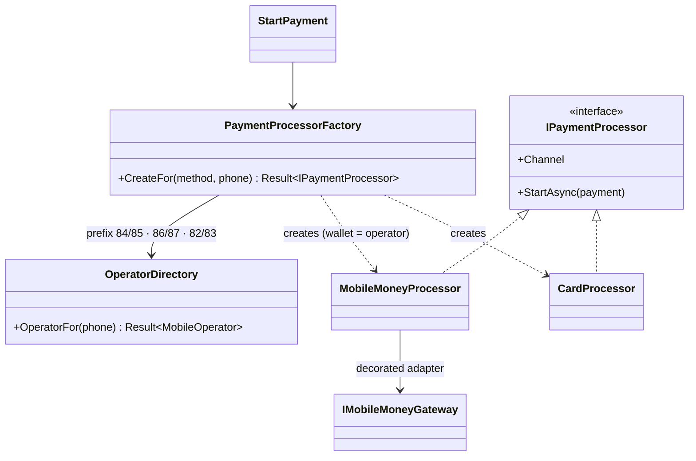

# Factory Method

## Problem

A Mozambican customer pays with whichever wallet their SIM card has, and the operator is known from
the phone number:

- **84 / 85:** Vodacom M-Pesa;
- **86 / 87:** Movitel e-Mola;
- **82 / 83:** Tmcel mKesh.

The checkout also offers cards (through the SIMO network) and cash on delivery. Each way to pay is
collected differently:

- a mobile wallet sends a PIN prompt to the phone and answers later by callback;
- a card is authorised synchronously;
- cash is never "requested" at all; the courier collects it.

Two kinds of mistakes have to be caught *before* anything is sent to an operator:

- a number with a prefix no operator uses (89…);
- a customer who picked e-Mola but typed an M-Pesa number.

Numbering plans change, so the prefixes must come from configuration.

## Naive solution

```csharp
// In the payment handler, and again in the retry handler, and again in the back-office "resend PIN":
if (method == "MPesa" && (phone.StartsWith("25884") || phone.StartsWith("25885")))
    await new MPesaClient(http).Pay(...);
else if (method == "EMola" && phone.StartsWith("25886") ...)   // 87 forgotten here
    ...
else if (method == "Card") ...
// Every new operator or prefix touches every copy; a mismatch slips through as an operator error.
```

## Solution

`PaymentProcessorFactory.CreateFor(method, phone)` is the **one place** that decides which
`IPaymentProcessor` collects a payment:

- **Mobile wallets.** `OperatorDirectory` looks up the operator from the phone's two-digit prefix,
  using the configured `Payments:Operators:*:Prefixes`. The factory then checks the result against
  the chosen wallet. If they match, it creates a `MobileMoneyProcessor` around that operator's gateway.
- **Cards.** The factory creates a `CardProcessor`.
- **Cash on delivery and unknown methods** return a typed `GatewayError` (`UnsupportedMethod`), as do
  `UnknownOperator`, `InvalidNumber` and `WalletMismatch`. No exception is thrown, and no operator is
  called.

Callers (`PaymentHandlers.StartPayment`) only see `IPaymentProcessor.StartAsync(payment)`. They never
construct a processor or know that operators exist.



This is the "parameterised factory method" variant: one creation method that branches on input data,
rather than one subclass per creator. Here the variation is in the data (the phone and the method),
not in who is creating.

## Where in the code

- [PaymentProcessors.cs](../../src/Modules/Payments/Kanimambo.Payments.Application/Processing/PaymentProcessors.cs)
  (`PaymentProcessorFactory`, `OperatorDirectory`, `MobileMoneyProcessor`, `CardProcessor`)
- Prefixes in [appsettings.json](../../src/Kanimambo.Api/appsettings.json) (`Payments:Operators`)
- Used by `PaymentHandlers.Handle(StartPayment)` in
  [PaymentRequests.cs](../../src/Modules/Payments/Kanimambo.Payments.Application/PaymentRequests.cs)

## Tests

- [PaymentProcessorFactoryTests](../../tests/Kanimambo.Payments.UnitTests/FactoryMethod/PaymentProcessorFactoryTests.cs):
  - every prefix from 82 to 87 gets its operator;
  - unknown prefix (89), malformed numbers, wallet mismatch, card, cash on delivery and `None`;
  - the mobile-money processor asks for a PIN with the right callback URL and deadline;
  - an operator refusal fails the payment with its native code;
  - cards settle synchronously.
- [MobileMoneyPaymentTests](../../tests/Kanimambo.Payments.IntegrationTests/MobileMoneyPaymentTests.cs):
  `UnknownOperator` and `WalletMismatch` fail the order's payment without calling any operator.

## Trade-offs & when NOT to use

- **Reach for it when creation has a real decision.** If there were one payment gateway, `new` (or DI)
  would be enough.
- **Construction rules live in one class.** Adding a payment method means touching the factory. That
  is the point, but it is still a switch. With dozens of methods, keyed DI registrations or a
  registry of `IPaymentProcessorProvider`s would scale better.
- **Prefix routing is a heuristic.** Number portability would break it (Mozambique doesn't have it
  today). The wallet-mismatch check turns that kind of surprise into a clear error, not an operator
  failure.
