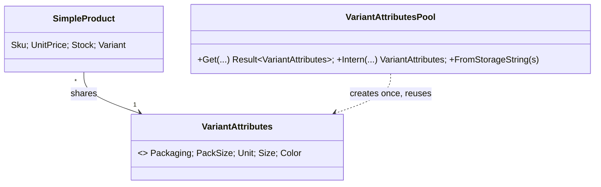

# Flyweight

## Problem

A wholesaler's catalog has thousands of SKUs, but only a few dozen distinct *variant attributes*:
"saco 25 kg", "caixa 12 un", "bidão 5 l", "unidade · azul"... Every import and every query
materializes those attributes again for each product, and every row carries its own copies of the
same strings. In memory-heavy paths (bulk imports, catalog caches, search projections) that
duplication is pure waste.

## Naive solution

```csharp
public sealed class ProductVariant
{
    public string Sku { get; }
    public decimal Price { get; }
    public string Packaging { get; }   // "saco" — a new string instance per row
    public decimal PackSize { get; }   // 25
    public string Unit { get; }        // "kg"  — another one
    public string? Size { get; }
    public string? Color { get; }
}
```

Why it hurts: 100 000 SKUs mean 100 000 copies of a handful of distinct values, all kept alive as
long as the products are.

## Solution

Variant attributes are split into two kinds of state:

- **Intrinsic (shared):** `VariantAttributes` — packaging, pack size, unit, size, colour. It is
  immutable and compared by value.
- **Extrinsic (per product):** SKU, price, stock, which stay on the `SimpleProduct`.

`VariantAttributesPool` is the flyweight factory: it returns the single shared instance for a
combination and creates it on first use.



Design points:

- **Lookups don't allocate.** The pool is keyed by a `readonly record struct` over the caller's own
  strings (compared case-insensitively), so a lookup on an existing combination allocates nothing.
  A unit test asserts no per-lookup allocation.
- **EF Core materializes through the pool.** The `Variant` column has a value converter that calls
  `VariantAttributesPool.Shared.FromStorageString`, so 2,400 imported SKUs loaded from PostgreSQL
  share about 20 objects. The integration test asserts this with reference equality.
- **Bounded growth.** The pool grows with the number of distinct combinations, not with the number of
  SKUs.

## Results (100 000 variants, 16 distinct combinations)

Measured on .NET 10.0.13, Intel Core i5-1335U, with
`dotnet run -c Release --project tests/Kanimambo.Benchmarks -- --filter *Flyweight* --job short`
(BenchmarkDotNet `MemoryDiagnoser`) and `-- --retained`.

| Strategy | Allocated per run | Retained after rows are discarded | Retained per variant |
|---|---:|---:|---:|
| Duplicated attributes | 9.92 MB | 22.22 MB | 233 B |
| **Flyweight (pooled attributes)** | **6.10 MB (−38%)** | **10.68 MB (−52%)** | **112 B** |

Reading the numbers:

- **What's left after pooling is the extrinsic state.** About 112 B per variant remain: the SKU string
  and the product object itself.
- **Retained memory is the bigger win.** The duplicated version keeps every row's attribute strings
  alive long after the import finished.
- **Time is within noise.** Mean time was 16.1 ms vs 14.6 ms, but the short job's error bars overlap,
  so this pattern is about memory, not speed.

## Where in the code

- [VariantAttributes.cs](../../src/Modules/Catalog/Kanimambo.Catalog.Domain/Variants/VariantAttributes.cs),
  [VariantAttributesPool.cs](../../src/Modules/Catalog/Kanimambo.Catalog.Domain/Variants/VariantAttributesPool.cs)
- EF converter: [CatalogDbContext.cs](../../src/Modules/Catalog/Kanimambo.Catalog.Infrastructure/Persistence/CatalogDbContext.cs)
- Importers use the pool:
  [TabularColumns.cs](../../src/Modules/Catalog/Kanimambo.Catalog.Infrastructure/Imports/TabularColumns.cs),
  [ImportValues.cs](../../src/Modules/Catalog/Kanimambo.Catalog.Infrastructure/Imports/ImportValues.cs)
- Benchmark: [tests/Kanimambo.Benchmarks/Flyweight](../../tests/Kanimambo.Benchmarks/Flyweight)

## Tests

- [VariantAttributesPoolTests](../../tests/Kanimambo.Catalog.UnitTests/Flyweight/VariantAttributesPoolTests.cs)
  cover:
  - one instance per combination, case-insensitively;
  - the storage round-trip returning the shared instance;
  - 100 000 SKUs sharing 5 objects;
  - no per-lookup allocation.
- [ImportApiTests](../../tests/Kanimambo.Catalog.IntegrationTests/ImportApiTests.cs) checks that 2,400
  SKUs materialized by EF share at most 20 attribute objects.

## Trade-offs & when NOT to use

- **Only for immutable shared state.** If attributes could be edited per product, sharing them would
  be a bug.
- **Process-wide state.** `VariantAttributesPool.Shared` is static because EF value converters cannot
  take injected services. That is acceptable for immutable, bounded data; anything else should be a
  DI singleton.
- **Not worth it for small collections.** With a few hundred products the saving is noise, and the
  extra indirection isn't free in readability.
- **Not a replacement for normalization.** In the database the attributes are a compact column; the
  pattern addresses *in-memory* duplication.
