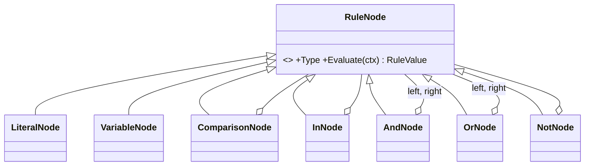

# Interpreter

## Problem

Marketing launches promotions every week: *"5% off with M-Pesa in Maputo above 2 500 MZN"*,
*"150 MZN off any cabaz"*, *"3% for B2B customers in Matola and Maputo"*. Hard-coding each rule
means a developer, a release and a deploy for every campaign. Marketing needs to **write the
condition themselves**, store it, and have it apply immediately. Mistakes must be caught when the
rule is saved, with a clear message, not at checkout time.

## Naive solution

```csharp
if (promo.Code == "MPESA5" && cart.Total >= 2500 && city == "Maputo" && method == "MPesa") ...
else if (promo.Code == "CABAZ150" && cart.Categories.Contains("cabazes")) ...
// …a new branch and a deploy per campaign. Or: store C# snippets and compile them at runtime (unsafe).
```

## Solution

A small, safe rule language with a grammar, a tokenizer, a parser and an AST that **interprets
itself**:

```
cart.total >= 2500 AND customer.city = "Maputo" AND payment.method = "MPesa"
"cabazes" IN cart.categories
customer.type = "b2b" AND customer.city IN ["Matola", "Maputo"]
NOT (payment.method = "CashOnDelivery") OR today.weekday = "Friday"
```

```
rule       := or END
or         := and ( OR and )*
and        := not ( AND not )*
not        := NOT not | comparison
comparison := operand ( (= | != | > | >= | < | <=) operand | IN operand )?
operand    := NUMBER | "TEXT" | TRUE | FALSE | variable | ( or ) | [ "TEXT", ... ]
```

The pipeline:

1. **`RuleLexer`.** Turns the text into tokens, each with its position. Keywords and identifiers are
   case-insensitive.
2. **`RuleParser`.** A recursive-descent parser that builds the AST. It also **type-checks** against a
   fixed vocabulary (`RuleVariables`): `cart.total` is a number, `customer.city` is text,
   `cart.categories` is a list of text, and so on. It rejects comparing a number with text, using `>`
   on text, `IN` on a non-list, a non-boolean rule, unknown variables (with a "did you mean"
   suggestion), and syntax errors.
3. **AST nodes.** `LiteralNode`, `VariableNode`, `ComparisonNode`, `InNode`, `AndNode`, `OrNode` and
   `NotNode` each implement `Evaluate(RuleContext)` (short-circuiting) and `ToString()`, which gives
   the canonical form.



How rules flow through the system:

- **Storing and evaluating.** A promotion stores its rule **as text**, exactly as marketing wrote it,
  in `promotions.Promotions.RuleText`. It is parsed and validated on creation, then parsed again
  lazily after loading. `PromotionEvaluator` builds a `RuleContext` from the cart (subtotal, item
  count, categories, city, customer type, payment method, weekday in Maputo time). It then evaluates
  every active promotion and returns the best discount, or `NoPromotion`.
- **Errors carry a position.** The position is 1-based, with the length of the offending text and a
  message, for example `Position 20: Unexpected 'AN': expected AND, OR or end of rule.`
  `POST /api/promotions/rules/validate` also returns a caret excerpt for the editor:

  ```
  cart.total >= 2500 AN customer.city = "Maputo"
                     ^^
  ```

## Where in the code

- Language:
  [Rules/](../../src/Modules/Promotions/Kanimambo.Promotions.Domain/Rules)
  (`RuleLexer.cs`, `RuleParser.cs`, `RuleNodes.cs`, `RuleVariables.cs`, `RuleValue.cs`)
- Promotion aggregate:
  [Promotion.cs](../../src/Modules/Promotions/Kanimambo.Promotions.Domain/Promotion.cs)
- Evaluation:
  [PromotionEvaluator.cs](../../src/Modules/Promotions/Kanimambo.Promotions.Application/PromotionEvaluator.cs)
- Back-office API:
  [PromotionsController.cs](../../src/Modules/Promotions/Kanimambo.Promotions.Api/Controllers/PromotionsController.cs)

## Tests

- [RuleEvaluationTests](../../tests/Kanimambo.Promotions.UnitTests/Interpreter/RuleEvaluationTests.cs) cover:
  - the marketing example at its boundaries;
  - precedence, parentheses, `IN` with lists and variables, `NOT`;
  - case-insensitivity, decimals, weekday;
  - one compiled rule evaluated 1 000 times.
- [RuleDiagnosticsTests](../../tests/Kanimambo.Promotions.UnitTests/Interpreter/RuleDiagnosticsTests.cs):
  14 kinds of mistake, each with its exact position and message, plus the caret excerpt.
- [PromotionEvaluatorTests](../../tests/Kanimambo.Promotions.UnitTests/PromotionEvaluatorTests.cs) cover:
  - best discount wins;
  - validity windows;
  - weekday in Maputo time;
  - discount caps.
- [PromotionsApiTests](../../tests/Kanimambo.Promotions.IntegrationTests/PromotionsApiTests.cs) cover:
  - a 400 with the position;
  - the validate endpoint;
  - **a rule saved as text in PostgreSQL applying to a real cart and stopping when deactivated**.

## Trade-offs & when NOT to use

- **You now maintain a language.** Every new variable or operator needs grammar, type-checking, tests
  and documentation. Keep the vocabulary small and business-shaped.
- **It isn't a programming language, and shouldn't become one.** No loops, no functions, no
  arithmetic. If marketing needs that, use a proper rules engine or a decision table instead of
  growing this grammar.
- **Not for rules that rarely change.** Use plain code there. The interpreter pays off only when the
  people who change the rules aren't developers and the rules change faster than releases.
