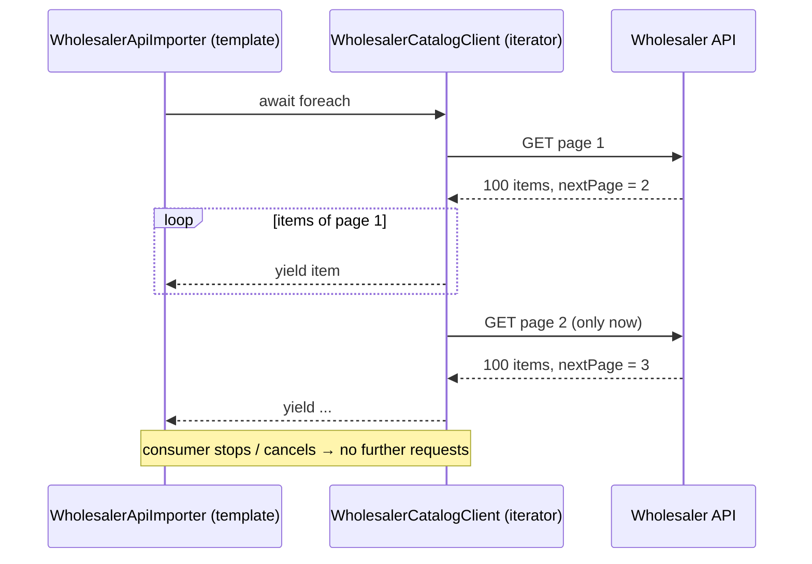

# Iterator

## Problem

A wholesaler publishes its catalog through a **paginated, slow** HTTP API (hundreds of milliseconds
per page, thousands of SKUs). Kanimambo imports it into a seller's catalog. Loading everything first
would hold the whole catalog in memory. It would also make the importer wait for the last page before
doing any work, and it couldn't stop early when the user cancels or the connection drops.

## Naive solution

```csharp
var all = new List<WholesalerProduct>();
for (var page = 1; ; page++)
{
    var response = await http.GetFromJsonAsync<Page>($"api/products?page={page}");
    all.AddRange(response.Items);              // the entire catalog accumulates here
    if (response.NextPage is null) break;
}
return all;                                    // the caller sees nothing until every page arrived
```

Why it hurts:

- **Memory grows with catalog size.**
- **Paging leaks into every caller.** The loop is copied wherever the catalog is consumed.
- **Cancellation is ignored.** It doesn't stop the remaining requests.

## Solution

`IWholesalerCatalog.StreamProductsAsync` returns an `IAsyncEnumerable<WholesalerProduct>`. The
paging loop is hidden inside the iterator:

- **Lazy requests.** A page is requested only when the consumer has used up the previous one.
- **One page in memory.** Only the current page is referenced; the next page replaces it.
- **Cancellation stops the remaining requests.** It flows in through `[EnumeratorCancellation]`.



The iterator is the **Read** step of the [Template Method](TemplateMethod.md) importer
(`WholesalerApiImporter`), and the template persists in batches of 200. Memory therefore stays flat
end to end: one page in the iterator, one batch in the change tracker.

## Where in the code

- Port:
  [Wholesaler.cs](../../src/Modules/Catalog/Kanimambo.Catalog.Application/Abstractions/Wholesaler.cs)
- Iterator:
  [WholesalerCatalogClient.cs](../../src/Modules/Catalog/Kanimambo.Catalog.Infrastructure/Wholesaler/WholesalerCatalogClient.cs)
- Consumer:
  [WholesalerApiImporter.cs](../../src/Modules/Catalog/Kanimambo.Catalog.Infrastructure/Imports/WholesalerApiImporter.cs)
- Local API:
  [Kanimambo.Simulators.Wholesaler](../../src/Simulators/Kanimambo.Simulators.Wholesaler) (2,400 SKUs,
  300 ms per page)

## Tests

- [WholesalerCatalogClientTests](../../tests/Kanimambo.Catalog.UnitTests/Iterator/WholesalerCatalogClientTests.cs)
  use a fake API that records the requested pages:
  - taking 5 items requests 1 page;
  - while items of page *N* are consumed, the last page requested is *N*, so at most one page is
    buffered;
  - the whole catalog streams in order;
  - cancelling after 150 items stops at page 2.
- [SimulatorContractTests](../../tests/Kanimambo.Catalog.IntegrationTests/SimulatorContractTests.cs)
  stream the simulator's 2,400 products through the production client.
- [ImportApiTests](../../tests/Kanimambo.Catalog.IntegrationTests/ImportApiTests.cs) import them end
  to end.

## Trade-offs & when NOT to use

- **A stream is consumed once.** Consumers that need several passes (sorting, counting first) must
  materialize, and then the iterator buys nothing.
- **Failures can arrive mid-stream.** The importer turns an `HttpRequestException` during enumeration
  into a fatal report, and the unit of work rolls back the batches already written.
- **Not worth it for small single-page APIs.** A plain `GetFromJsonAsync<List<T>>` is simpler there.
