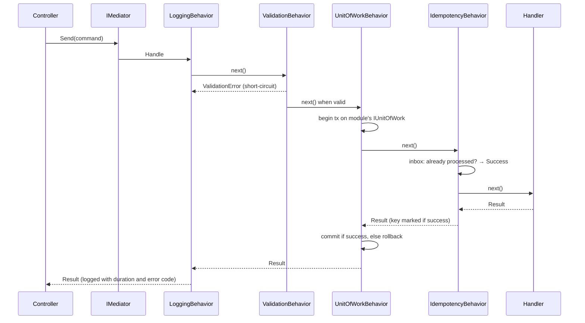
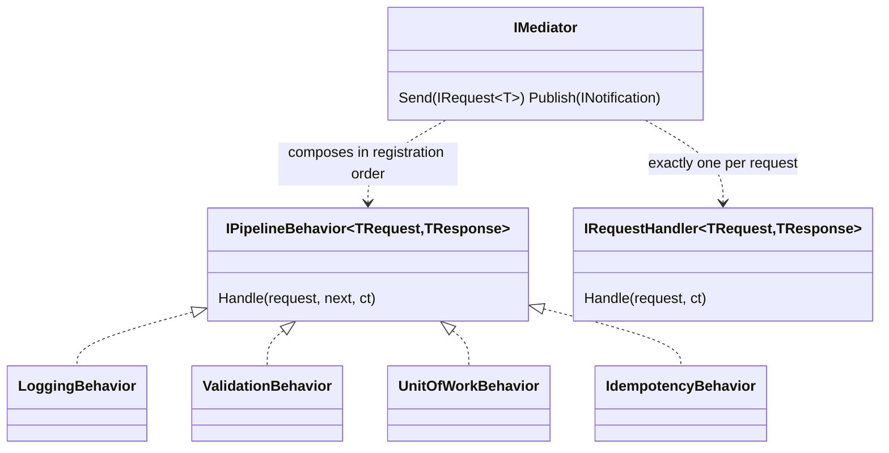

# Mediator

## Problem

Every write in Kanimambo Market needs the same cross-cutting treatment. A checkout, a back-office
"suspend seller" and an M-Pesa payment callback all need structured logging and tracing, input
validation, a transaction on the right module's database, and protection against duplicate delivery.
Customers and couriers on unstable mobile networks retry often, and payment gateways re-send
callbacks.

Controllers must stay thin, and modules must not know about each other.

## Naive solution

Each controller or service repeats the plumbing:

```csharp
[HttpPost("{id}/suspend")]
public async Task<IActionResult> Suspend(Guid id)
{
    _logger.LogInformation("Suspending {Id}", id);
    if (id == Guid.Empty) return BadRequest();               // validation, ad hoc
    await using var tx = await _catalogDb.Database.BeginTransactionAsync();
    try
    {
        var seller = await _catalogDb.Sellers.FindAsync(id);  // controller touches the DbContext
        var result = seller.Suspend(_clock.GetUtcNow());
        if (result.IsFailure) { await tx.RollbackAsync(); return UnprocessableEntity(); }
        await _catalogDb.SaveChangesAsync();
        await tx.CommitAsync();
        return NoContent();
    }
    catch (Exception ex) { _logger.LogError(ex, "..."); throw; }
}
```

Why it hurts:

- the plumbing is copied into every endpoint and drifts over time;
- forgetting the transaction or the validation compiles fine;
- controllers depend on infrastructure;
- adding a new concern (metrics, an idempotency inbox) means editing every endpoint.

## Solution

Requests (`ICommand`, `ICommand<T>`, `IQuery<T>`) are sent through `IMediator`, which finds the
request's single handler and wraps it in an ordered pipeline of behaviors. Which requests a behavior
applies to is expressed with **generic constraints**, not runtime `if`s. For example,
`UnitOfWorkBehavior` is constrained to `ICommandBase`, so queries are never wrapped in a transaction.

The implementation is in-house (MediatR is commercially licensed). See
[ADR 0002](../adr/0002-in-house-mediator.md).





Key design points:

- **Order is explicit.** Behaviors run in the order they are registered in
  [`Program.cs`](../../src/Kanimambo.Api/Program.cs), and the first one registered is the outermost.
- **Reflection runs once per message type.** A strongly typed wrapper is built and cached; every
  later dispatch goes through generic code only.
- **Per-module transactions.** Request assemblies are mapped to modules (`AddModule("Catalog", ...)`),
  and each module registers its own keyed `IUnitOfWork` and `IInboxStore`.
- **Isolated notification handlers.** One failing handler does not prevent the others from running.
  Failures are reported together afterwards (the durable guarantee comes from the outbox in Phase 3).
- **Idempotency runs inside the unit of work.** The processed key is therefore committed atomically
  with the command's own changes.

## Where in the code

- Abstractions:
  [IRequest.cs](../../src/Kanimambo.SharedKernel/Messaging/IRequest.cs), [ICommand.cs](../../src/Kanimambo.SharedKernel/Messaging/ICommand.cs), [ICommand{TValue}.cs](../../src/Kanimambo.SharedKernel/Messaging/ICommand{TValue}.cs), [IQuery.cs](../../src/Kanimambo.SharedKernel/Messaging/IQuery.cs), [INotification.cs](../../src/Kanimambo.SharedKernel/Messaging/INotification.cs), [IIdempotentCommand.cs](../../src/Kanimambo.SharedKernel/Messaging/IIdempotentCommand.cs),
  [IRequestHandler.cs](../../src/Kanimambo.SharedKernel/Messaging/IRequestHandler.cs), [INotificationHandler.cs](../../src/Kanimambo.SharedKernel/Messaging/INotificationHandler.cs), [IPipelineBehavior.cs](../../src/Kanimambo.SharedKernel/Messaging/IPipelineBehavior.cs),
  [IMediator.cs](../../src/Kanimambo.SharedKernel/Messaging/IMediator.cs)
- Dispatcher: [Mediator.cs](../../src/Kanimambo.SharedKernel/Messaging/Mediator.cs)
- Registration:
  [MediatorServiceCollectionExtensions.cs](../../src/Kanimambo.SharedKernel/Messaging/MediatorServiceCollectionExtensions.cs),
  [MediatorOptions.cs](../../src/Kanimambo.SharedKernel/Messaging/MediatorOptions.cs)
- Behaviors: [Messaging/Behaviors](../../src/Kanimambo.SharedKernel/Messaging/Behaviors)

## Tests

- [PipelineBehaviorTests](../../tests/Kanimambo.SharedKernel.UnitTests/Messaging/PipelineBehaviorTests.cs)
  cover:
  - registration order;
  - validation short-circuit;
  - commit and rollback;
  - queries excluded by constraint;
  - a missing unit of work;
  - duplicate delivery.
- [MediatorDispatchTests](../../tests/Kanimambo.SharedKernel.UnitTests/Messaging/MediatorDispatchTests.cs)
  cover:
  - single-handler dispatch;
  - a missing handler;
  - isolated notification handlers;
  - dispatch on the runtime type.

## Trade-offs & when NOT to use

- **Indirection.** "Go to definition" on `Send` doesn't take you to the handler; naming conventions
  (`XCommand` / `XCommandHandler`) compensate for that.
- **Not a module bus.** It doesn't replace integration events between modules. Cross-module reactions
  go through the outbox (Phase 3), not through a synchronous `Send` into another module.
- **Overkill for small apps.** A small CRUD app with three endpoints doesn't need it: a service class
  called directly is simpler.
- **Not for hot paths.** Avoid it where per-call allocation matters. The pipeline allocates a closure
  per behavior per call, which is negligible for HTTP requests but not for tight loops.
