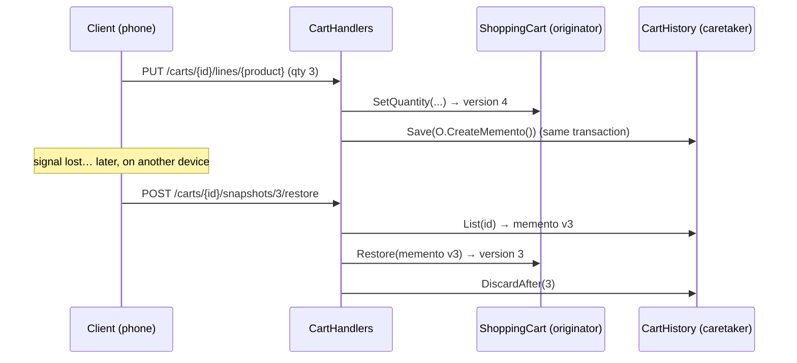

# Memento

## Problem

Mozambican shoppers often lose mobile signal halfway through building a cart, or switch from a phone
to a family member's device to finish the order. They need to:

- **see recent states:** "what did my cart look like before the network dropped?";
- **go back to one:** the state their phone last confirmed, or simply undo the last change;
- **never get a corrupted cart:** half-applied edits, or two devices silently overwriting each other.

The cart's internals (lines, quantities, delivery city, version) must stay encapsulated. The history
mechanism must not reach into them or duplicate cart logic.

## Naive solution

```csharp
// Keep an audit table of operations and replay them backwards…
if (op.Type == "SetQuantity") cart.Lines.Single(l => l.ProductId == op.ProductId).Quantity = op.OldQuantity;
else if (op.Type == "Remove") cart.Lines.Add(new CartLine(op.ProductId, op.OldQuantity));   // needs public setters
else if (op.Type == "ChangeCity") cart.DeliveryCity = op.OldCity;
// …every new cart operation needs a matching "inverse", and a bug in one corrupts the cart.
```

Why it hurts:

- **Encapsulation breaks.** The undo code needs write access to the cart's internals, so they can't
  stay private.
- **Undo logic grows with every operation.** Each new cart operation needs its own inverse.
- **Going back several steps is fragile.** It means replaying inverses in exact order.

## Solution

- **Originator — `ShoppingCart`.** It creates a `CartMemento` of its editable state and can restore
  itself from one. Only the cart knows how to do either.
- **Memento — `CartMemento`.** An immutable record (`ImmutableArray` of lines, with version, time and
  delivery city) that serializes to JSON. Ownership is deliberately excluded, so restoring never
  changes who the cart belongs to.
- **Caretaker — `ICartHistory`.** It stores the mementos in `cart.CartSnapshots` as `jsonb`, keyed by
  (cart, version), without inspecting them. After every change the handler saves a snapshot in the
  same unit of work, so the change and its snapshot commit together.
- **Linear history.** Going back to snapshot *N* (`restore`, or `undo` = the previous snapshot)
  discards the snapshots after *N*, and the next change becomes version *N + 1*. Only the latest 20
  are kept.
- **Optimistic concurrency.** The `Carts` row uses PostgreSQL `xmin`. Two devices saving the same
  version get `409 concurrency.conflict` instead of overwriting each other.



B2B draft orders (Ordering) reuse the same shape: `DraftOrder` is the originator, `DraftOrderMemento` the
snapshot, and `POST /api/order-drafts/{id}/undo` lets the customer or the back-office undo an edit (see
[Prototype](Prototype.md)).

## Where in the code

- Originator and memento:
  [ShoppingCart.cs](../../src/Modules/Cart/Kanimambo.Cart.Domain/ShoppingCart.cs),
  [CartMemento.cs](../../src/Modules/Cart/Kanimambo.Cart.Domain/CartMemento.cs)
- Caretaker port and use:
  [CartModule.cs](../../src/Modules/Cart/Kanimambo.Cart.Application/CartModule.cs),
  [CartRequests.cs](../../src/Modules/Cart/Kanimambo.Cart.Application/CartRequests.cs)
- Storage:
  [CartPersistence.cs](../../src/Modules/Cart/Kanimambo.Cart.Infrastructure/CartPersistence.cs),
  [CartDbContext.cs](../../src/Modules/Cart/Kanimambo.Cart.Infrastructure/CartDbContext.cs) (`xmin`)
- Endpoints:
  [CartsController.cs](../../src/Modules/Cart/Kanimambo.Cart.Api/Controllers/CartsController.cs)
  (`snapshots`, `snapshots/{version}/restore`, `undo`)

## Tests

- [CartMementoTests](../../tests/Kanimambo.Cart.UnitTests/Memento/CartMementoTests.cs) cover:
  - a version per change;
  - **restoring snapshot N returns exactly that state**;
  - snapshots staying unaffected by later changes;
  - the JSON round-trip;
  - restore keeping the owner;
  - rejecting snapshots from the future.
- [CartHistoryApiTests](../../tests/Kanimambo.Cart.IntegrationTests/CartHistoryApiTests.cs) cover,
  against PostgreSQL:
  - restoring snapshot 3 of 5, with history truncation and renumbering;
  - undo all the way back to the empty cart, then 409;
  - pruning to the last 20 snapshots, stored as `jsonb`;
  - two devices conflicting on `xmin`.

## Trade-offs & when NOT to use

- **Snapshots cost storage.** Snapshotting the whole state is cheap for a cart (a few lines), but would
  be wasteful for large aggregates. Use deltas or event sourcing there.
- **Stored snapshots must stay readable.** Mementos outlive code changes. Keep the record backward
  compatible, or version it.
- **Not for one-step reversal of a destructive action.** When undo is a single domain operation
  ("cancel order"), a [Command](Command.md) with an explicit `Undo` is clearer than restoring a
  snapshot.
