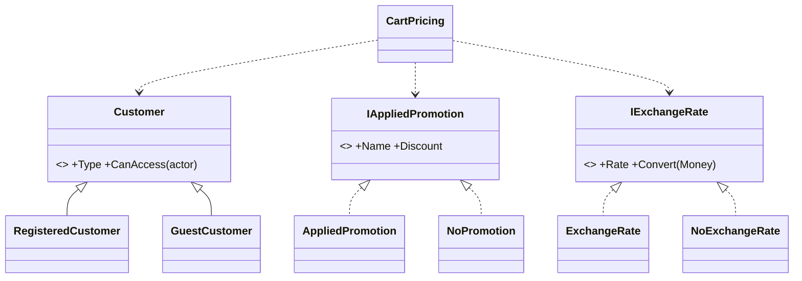

# Null Object

## Problem

Pricing a cart for checkout combines three things that are often "absent":

- **the customer:** many shoppers buy without an account;
- **the promotion:** usually none applies;
- **the exchange rate:** most of the catalog is already priced in MZN.

Every absence becomes a branch, and every branch is a place to forget a check and crash at checkout.

## Naive solution

```csharp
var customerType = customer is null ? "guest" : customer.IsBusiness ? "b2b" : "registered";
foreach (var line in cart.Lines)
{
    var rate = line.Currency == "MZN" ? null : await rates.GetAsync(line.Currency);
    var total = rate is null ? line.Total : line.Total * rate.Value;          // easy to get backwards
    subtotal += total;
}
var promotion = await promotions.FindBestAsync(ctx);
var discount = promotion is null ? 0m : promotion.DiscountFor(subtotal);       // forget this → NRE
var name = promotion?.Name ?? "";
```

## Solution

Each "absent" case is a real object with neutral behaviour:

| Null Object | Stands for | Behaviour |
|---|---|---|
| `GuestCustomer` (Cart) | anonymous shopper | type `guest`; access granted to whoever holds the (random) cart id |
| `NoPromotion` (Promotions.Contracts) | no rule matched | name `""`, discount `0 MZN` |
| `NoExchangeRate` (SharedKernel) | price already in MZN | rate 1, `Convert` is the identity; no upstream call |

`CartPricing` therefore converts **every** line with its rate, subtracts **the** promotion's
discount, and reads **the** customer's type, with no branch. "Absent" is translated once, at the
boundary that knows about it:

- `Customer.Restore` maps the database's null `CustomerId` to the guest;
- the exchange-rate proxy returns `NoExchangeRate` for MZN → MZN;
- `PromotionEvaluator` starts its search from `NoPromotion`.



## Where in the code

- [Customers.cs](../../src/Modules/Cart/Kanimambo.Cart.Domain/Customers.cs) (`GuestCustomer`)
- [PromotionContracts.cs](../../src/Modules/Promotions/Kanimambo.Promotions.Contracts/PromotionContracts.cs) (`NoPromotion`)
- [ExchangeRates.cs](../../src/Kanimambo.SharedKernel/Domain/ExchangeRates.cs) (`NoExchangeRate`)
- The flow without branches:
  [CartPricing.cs](../../src/Modules/Cart/Kanimambo.Cart.Application/Pricing/CartPricing.cs)
- Translation at the edges:
  [CachingExchangeRateProxy.cs](../../src/Modules/Catalog/Kanimambo.Catalog.Infrastructure/ExchangeRates/CachingExchangeRateProxy.cs),
  [PromotionEvaluator.cs](../../src/Modules/Promotions/Kanimambo.Promotions.Application/PromotionEvaluator.cs)

## Tests

- [CartPricingTests](../../tests/Kanimambo.Cart.UnitTests/NullObject/CartPricingTests.cs) cover:
  - a guest, MZN-only, no-promotion cart going through the same path as everyone;
  - unavailable lines priced with `NoExchangeRate`;
  - the identity conversion.

  A reflection test asserts with `NullabilityInfoContext` that the priced cart and lines expose no
  nullable customer, promotion or rate, and that the evaluator returns
  `Task<IAppliedPromotion>`, never null.
- [CustomerTests](../../tests/Kanimambo.Cart.UnitTests/NullObject/CustomerTests.cs) cover:
  - the guest singleton;
  - access rules;
  - restoring from null columns.
- [PromotionEvaluatorTests](../../tests/Kanimambo.Promotions.UnitTests/PromotionEvaluatorTests.cs):
  no match returns the `NoPromotion` instance itself.
- [CartPricingApiTests](../../tests/Kanimambo.Cart.IntegrationTests/CartPricingApiTests.cs) cover the
  end-to-end discount of 0 and the exchange rate of 1 for MZN lines.

## Trade-offs & when NOT to use

- **It can hide real failures.** Absence must be a *legitimate* state. An exchange-rate API outage is
  **not** "no exchange rate": it is an error (`Unavailable`), and pricing fails loudly rather than
  quietly charging the USD amount in meticais.
- **The neutral behaviour must truly be neutral.** If callers start writing
  `if (promotion is NoPromotion)`, the null object has leaked and a plain optional would be more
  honest.
- **Not worth it for a single nullable field.** One nullable value checked in one place doesn't
  justify a class hierarchy.
