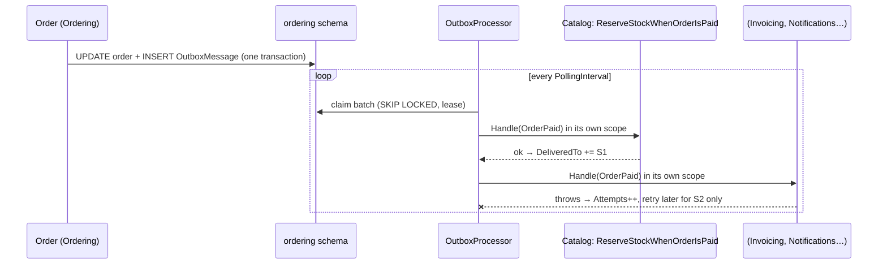

# Observer (with a transactional outbox)

## Problem

When an order is paid, several things must happen in different modules:

- reserve the stock (Catalog, now);
- issue the invoice (Invoicing, Phase 6);
- send an SMS to the customer and notify the seller (Notifications, Phase 7).

When it is placed, the cart must be closed (Cart).

Ordering must not know these subscribers, a slow or failing subscriber must not affect the others, and
nothing may be lost. If the process crashes right after the payment commits, the invoice must still be
issued.

## Naive solution

```csharp
order.ConfirmPayment(reference);
await db.SaveChangesAsync();
await catalog.ReserveStock(order);       // Ordering now depends on Catalog, Invoicing, SMS…
await invoicing.Issue(order);            // if this throws, the SMS below never goes out
await sms.Send(order.Customer.Phone);    // and if the process dies here, nobody ever retries
```

## Solution

**Observer, made durable.**

1. **Raising events.** Aggregates raise **domain events** (`OrderPlaced`, `OrderPaid`,
   `OrderStatusChanged`).
2. **Writing them to the outbox.** On `SaveChanges`, `OutboxInterceptor` maps them to public
   **integration events** using Ordering's mapper (`Kanimambo.Ordering.Contracts`). It writes them to
   `ordering.OutboxMessages` **in the same transaction** as the order. No commit means no event;
   a commit means the event is guaranteed to be delivered.
3. **Delivering them.** `OutboxProcessor` (a background service) claims batches with
   `FOR UPDATE SKIP LOCKED` plus a lease, so several API instances can run it. Then, for each message,
   it calls **every subscriber separately**:
   - each call gets its own DI scope, DbContext and transaction;
   - successful subscribers are recorded in `DeliveredTo` and never called again for that message;
   - failures are retried with exponential backoff, only for the subscribers still missing;
   - after `Outbox:MaxAttempts` the message is **dead-lettered**, kept with `LastError` for inspection.
4. **Handling duplicates.** Delivery is at-least-once, so subscribers are idempotent. They send an
   `IIdempotentCommand` keyed by the event id, which the Mediator's inbox de-duplicates
   (`ReserveStock`, `CloseCheckedOutCart`).



Subscribers live in their own modules and depend only on `Kanimambo.Ordering.Contracts`: Catalog for
stock, Cart for closing the cart, and Payments for collecting the money. Ordering doesn't know they
exist.

Events flow both ways without the modules referencing each other's internals:

1. Ordering publishes `OrderPaymentRequested`.
2. Payments starts collecting, and later publishes `PaymentConfirmed` / `PaymentFailed` from its own
   outbox.
3. Ordering subscribes to those through `Kanimambo.Payments.Contracts`, and marks the order paid or
   failed.

## Where in the code

- Generic outbox:
  [Outbox/](../../src/Kanimambo.SharedKernel.Infrastructure/Outbox)
  (`OutboxMessage`, `OutboxInterceptor`, `OutboxProcessor`), enabled with
  `AddModuleDbContext<T>(…, publishesEvents: true)`
- Ordering's events:
  [OrderingIntegrationEvents.cs](../../src/Modules/Ordering/Kanimambo.Ordering.Contracts/OrderingIntegrationEvents.cs),
  mapper:
  [OrderingIntegrationEventMapper.cs](../../src/Modules/Ordering/Kanimambo.Ordering.Infrastructure/OrderingIntegrationEventMapper.cs)
- Subscribers:
  [ReserveStock.cs](../../src/Modules/Catalog/Kanimambo.Catalog.Application/Stock/ReserveStock.cs) (bundles
  reserve their leaf products),
  [CartCheckout.cs](../../src/Modules/Cart/Kanimambo.Cart.Application/Checkout/CartCheckout.cs)

## Tests

- [LifecycleAndOutboxTests](../../tests/Kanimambo.Ordering.IntegrationTests/LifecycleAndOutboxTests.cs)
  run against PostgreSQL with a controllable extra subscriber:
  - **a subscriber failing twice is retried alone**: stock is reserved immediately and exactly once,
    and the message ends with `Attempts = 2` and both subscribers in `DeliveredTo`;
  - **a subscriber that never recovers is dead-lettered** after 3 attempts, while the others were
    served;
  - payment reserves stock;
  - a cash order reserves stock only on delivery;
  - a bundle reserves its components.
- [CheckoutTests](../../tests/Kanimambo.Ordering.IntegrationTests/CheckoutTests.cs): the cart is
  closed via `OrderPlaced`.

## Trade-offs & when NOT to use

- **Eventual consistency.** Subscribers react milliseconds to seconds later. Anything that must be
  atomic with the order belongs inside Ordering's transaction.
- **At-least-once delivery.** Every subscriber must be idempotent. The inbox makes that cheap, but it is
  a rule to remember.
- **Polling latency and load.** `PollingInterval` trades freshness for database queries. At scale, a
  broker (Kafka, RabbitMQ) fed by the outbox is the next step.
- **Not for in-module reactions that must happen in the same transaction.** Call the code directly
  instead.
