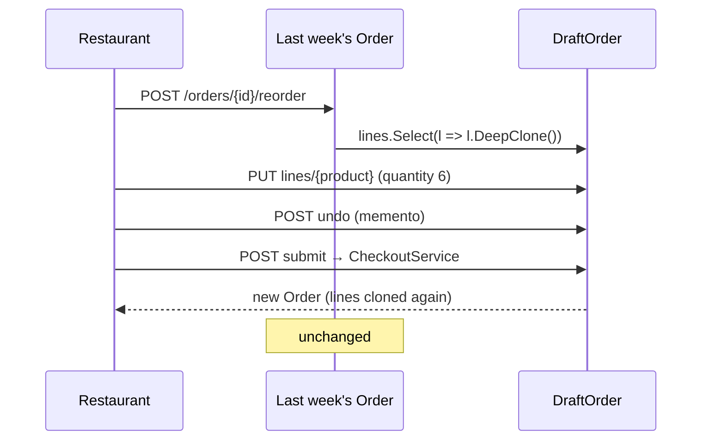

# Prototype

## Problem

Restaurants and grocers order from the same wholesaler every week, mostly the same products with
different quantities. Rebuilding the order from scratch each time is tedious and error-prone. They want
to **copy last week's order and adjust it**.

The copy must be fully independent: editing next week's draft can never change the record of what was
ordered (and invoiced) last week.

## Naive solution

```csharp
var draft = new Draft { Lines = lastWeek.Lines };   // shallow copy: both share the same line objects
draft.Lines[0].Quantity = 10;                       // …and last week's order just changed too
```

## Solution

`OrderLine` implements `IPrototype<OrderLine>.DeepClone()`, which returns a brand-new line with the same
values.

- **`DraftOrder.CloneFrom(order)`** clones the previous order into a draft with copies of every line.
  Only B2B customers can do this.
- **`Order.Place`** clones the lines again when the draft is submitted, so a placed order never shares
  objects with its source.
- **Editing happens on the draft.** `SetQuantity` changes it and every edit is snapshotted, so the
  customer or the back-office can undo it (see [Memento](Memento.md)).
- **Submitting goes through the normal checkout.** `POST /api/order-drafts/{id}/submit` uses the same
  [Facade](Facade.md) as a cart. Prices are refreshed from the catalog at that point, never copied.



## Where in the code

- [IPrototype.cs](../../src/Modules/Ordering/Kanimambo.Ordering.Domain/IPrototype.cs), [OrderLine.cs](../../src/Modules/Ordering/Kanimambo.Ordering.Domain/OrderLine.cs)
  (`IPrototype<T>`, `OrderLine.DeepClone`)
- [DraftOrder.cs](../../src/Modules/Ordering/Kanimambo.Ordering.Domain/DraftOrder.cs) (`CloneFrom`,
  memento)
- [DraftOrderHandlers.cs](../../src/Modules/Ordering/Kanimambo.Ordering.Application/DraftOrderHandlers.cs)
  (`ReorderAsDraft`, `SetDraftLine`, `UndoDraftChange`)

## Tests

- [ReorderPrototypeTests](../../tests/Kanimambo.Ordering.UnitTests/Prototype/ReorderPrototypeTests.cs) cover:
  - the clone having equal values but different instances;
  - **changing the clone (quantity, removal) leaving the original's lines and totals unchanged**;
  - a placed order owning copies of its lines;
  - consumers being refused;
  - undo restoring a removed line;
  - a submitted draft being frozen.
- [ReorderTests](../../tests/Kanimambo.Ordering.IntegrationTests/ReorderTests.cs) cover the whole B2B
  flow over HTTP against PostgreSQL: clone, adjust, undo, submit, then the original verified unchanged,
  and a resubmit returning the same order.

## Trade-offs & when NOT to use

- **Deep copies must be maintained.** Every new reference field needs a decision: copy it or share it.
  Value objects such as `Money` can be shared safely; mutable objects cannot.
- **Not a template mechanism.** If reorders should follow a fixed template ("every Monday, 10 sacks"),
  a stored recurring-order template is the better model.
- **Not for one-off copies of immutable records.** `with` expressions already cover that.
