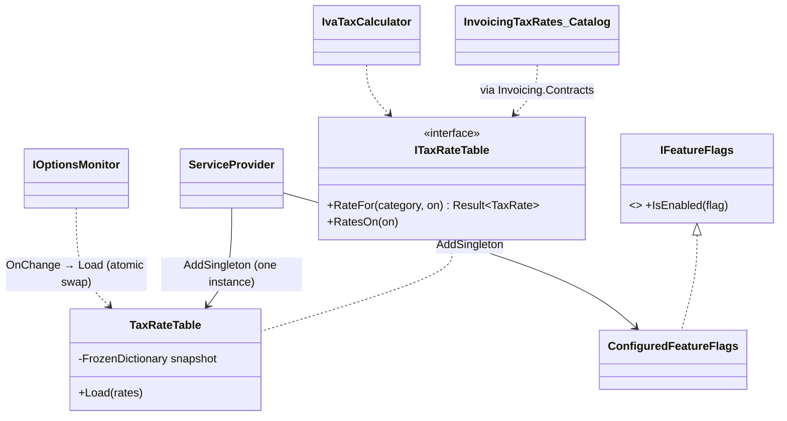

# Singleton

## Problem

Two pieces of state should exist **once** for the whole application:

- **The IVA rate table.** It is read on every product page (IVA breakdown), every checkout and every
  invoice line. It has legal history: the standard rate was 17% until 2022 and has been 16% since
  2023, and an invoice dated 2022 must use 17%. Rates change by law, so they live in configuration and
  must be reloadable without a restart. Every module must see the same table.
- **Feature flags,** used for gradual rollouts such as the XML e-Declaração file and PDF downloads.

Both are read constantly from many threads and rarely written.

## Naive solution

```csharp
public sealed class TaxRates
{
    public static TaxRates Instance { get; } = new(LoadFromFile());   // classic Singleton
    public decimal Iva = 0.16m;                                        // mutable, read by every thread
}
// decimal rate = TaxRates.Instance.Iva;  — hidden dependency, impossible to replace in a test,
// shared between parallel tests, and a reload that writes fields while other threads read them.
```

## Solution

**Singleton by DI lifetime, never by a static field** ([ADR 0010](../adr/0010-singletons-through-di.md)).

- **The rate table.** `TaxRateTable` is registered with `AddSingleton` and exposed through the
  `Kanimambo.Invoicing.Contracts.ITaxRateTable` contract:
  - it is the same instance for Invoicing and for the Catalog's IVA breakdown, which reads it through
    the contract;
  - **reads are lock-free and thread-safe.** The table is an immutable `FrozenDictionary` snapshot,
    with each category's rates sorted by `ValidFrom`. `RateFor(category, date)` reads the current
    snapshot through `Volatile.Read`;
  - **reloads are atomic.** `IOptionsMonitor.OnChange` calls `Load`, which validates the new table,
    builds a new snapshot and swaps the reference. A reader sees either the old table or the new one,
    never a mix;
  - an invalid table (a rate of 16 instead of 0.16, an exemption without a legal reason) is refused,
    and the current table stays.
- **Feature flags.** `IFeatureFlags` is implemented by `ConfiguredFeatureFlags`, using the same
  snapshot-and-swap technique, and registered once through `AddFeatureFlags`.



## Where in the code

- [TaxRateTable.cs](../../src/Modules/Invoicing/Kanimambo.Invoicing.Application/Tax/TaxRateTable.cs)
- Registration and reload wiring: [InvoicingInfrastructureExtensions.cs](../../src/Modules/Invoicing/Kanimambo.Invoicing.Infrastructure/InvoicingInfrastructureExtensions.cs)
- The Catalog's view of it: [InvoicingTaxRates.cs](../../src/Modules/Catalog/Kanimambo.Catalog.Infrastructure/Tax/InvoicingTaxRates.cs)
- Feature flags:
  [IFeatureFlags.cs](../../src/Kanimambo.SharedKernel/Features/IFeatureFlags.cs) and
  [ConfiguredFeatureFlags.cs](../../src/Kanimambo.SharedKernel.Infrastructure/Features/ConfiguredFeatureFlags.cs)
- Configuration: `Invoicing:TaxRates` (with `ValidFrom` per rate) and `Features:Flags` in
  [appsettings.json](../../src/Kanimambo.Api/appsettings.json)
- `GET /api/invoicing/tax-rates?on=2022-06-01`

## Tests

- [SingletonTests](../../tests/Kanimambo.Invoicing.UnitTests/Singleton/SingletonTests.cs):
  - the rate in force on each date (17% on 2022-12-31, 16% from 2023-01-01);
  - unknown categories and dates before any rate are errors;
  - invalid tables are refused, and the current one stays;
  - **50 000 parallel reads during 2 000 reloads never fail**;
  - **one instance** is served to the root and to scopes, through both the class and the contract,
    and it follows a configuration reload on that same instance;
  - feature flags are off unless configured, and follow reloads on the same instance.
- [InvoicingTests](../../tests/Kanimambo.Invoicing.IntegrationTests/InvoicingTests.cs): the tax-rates
  endpoint shows 16% today and 17% for 2022.
- [CatalogApiTests](../../tests/Kanimambo.Catalog.IntegrationTests/CatalogApiTests.cs): the bundle's
  IVA breakdown is computed from the same table.

## Trade-offs & when NOT to use

- **Not for state that varies per request or per user.** That belongs in a scoped service.
- **A singleton must not capture scoped services.** The `DbContext` is the classic trap. The rate table
  depends only on options.
- **Mutable singletons need care.** The snapshot-and-swap design is what makes this one safe. A
  singleton with fields updated in place would need locks on every read.
- **A static `Instance` is never needed here.** DI already guarantees one instance, while keeping the
  dependency visible in constructors and replaceable in tests.
