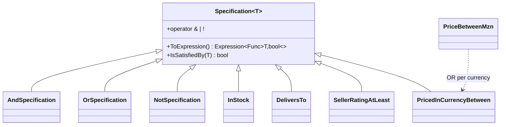

# Specification

## Problem

Customers filter the catalog by combining conditions, for example *in stock, between 500 and
2 000 MZN, groceries, delivered to Matola, from sellers rated 4 or more*. Several things make this
harder than it looks:

- the same rules are reused elsewhere (order validation checks "delivers to the customer's city");
- prices are stored in MZN, USD or ZAR depending on the seller;
- the catalog is too big to filter in memory, so the filter must run **in PostgreSQL**.

## Naive solution

```csharp
var query = db.Products.AsQueryable();
if (filter.InStock) query = query.Where(p => p.Stock > 0);
if (filter.MinPrice is { } min) query = query.Where(p => p.Price >= min);  // wrong for USD/ZAR prices
if (filter.City is { } city) query = query.Where(p => p.Seller.DeliveryZones.Any(z => z.City == city));
// ...repeated, slightly differently, in order validation and promotions
```

Why it hurts:

- each rule is duplicated and drifts between copies;
- an `OR` between rules is awkward;
- rules can't be tested on their own;
- a well-meant refactor such as `Where(p => IsDeliverable(p))` compiles fine but silently pulls rows
  into memory.

## Solution

A `Specification<T>` exposes its rule as an `Expression<Func<T, bool>>`. Specifications compose with
`&`, `|` and `!`. When two are combined, their **parameters are rebound into a single lambda** (no
`Expression.Invoke`), so the result stays a plain expression tree that EF Core translates to SQL. The
same rule can also be evaluated in memory with `IsSatisfiedBy`.

The catalog specifications run over the `CatalogEntry` read model, a database view that flattens each
product or bundle with the seller attributes the filters need:

- `InStock`;
- `InCategory`;
- `NameContains`;
- `DeliversTo`, which becomes `= ANY("DeliveryCities")` on a PostgreSQL array;
- `SellerRatingAtLeast`;
- `PricedInCurrencyBetween`.

`PriceBetweenMzn` is itself composed: with today's rates (through the exchange-rate
[Proxy](Proxy.md)), it ORs one `PricedInCurrencyBetween` per currency, with bounds converted into that
currency. The stored price is therefore compared directly in SQL.



`SearchCatalogHandler` starts from `Specification<CatalogEntry>.All` and adds only the requested
filters. `CatalogSearch` (Infrastructure) applies the specification to the view and returns one page.
`IQueryable` never leaves Infrastructure.

## Where in the code

- Base:
  [Specification.cs](../../src/Kanimambo.SharedKernel/Specifications/Specification.cs),
  [SpecificationExtensions.cs](../../src/Kanimambo.SharedKernel/Specifications/SpecificationExtensions.cs)
- Catalog rules:
  [CatalogSpecifications.cs](../../src/Modules/Catalog/Kanimambo.Catalog.Application/Search/CatalogSpecifications.cs),
  [SearchCatalog.cs](../../src/Modules/Catalog/Kanimambo.Catalog.Application/Search/SearchCatalog.cs)
- Execution:
  [Repositories.cs](../../src/Modules/Catalog/Kanimambo.Catalog.Infrastructure/Persistence/Repositories.cs)
  (`CatalogSearch`); view:
  [CatalogEntriesViewSql.cs](../../src/Modules/Catalog/Kanimambo.Catalog.Infrastructure/Persistence/CatalogEntriesViewSql.cs)

## Tests

- [SpecificationTests](../../tests/Kanimambo.SharedKernel.UnitTests/Specifications/SpecificationTests.cs)
  cover the combinators, and assert that a composed expression has a single parameter and no
  `InvocationExpression`, which is what makes it translatable.
- [CatalogSpecificationTests](../../tests/Kanimambo.Catalog.UnitTests/Specifications/CatalogSpecificationTests.cs)
  cover:
  - the catalog filters;
  - the MZN price range across currencies;
  - currencies with no rate available.
- [SpecificationInPostgresTests](../../tests/Kanimambo.Catalog.IntegrationTests/SpecificationInPostgresTests.cs)
  show that `ToQueryString()` yields one `WHERE` over `catalog.catalog_entries` (with `= ANY`,
  `"AvailableStock" > 0`, …) and that PostgreSQL returns exactly the expected seeded items.

## Trade-offs & when NOT to use

- **Translation is the author's job.** A specification is only as translatable as its expression:
  calling a C# method inside `ToExpression()` breaks SQL translation. Every new specification needs an
  integration test.
- **Use it only for reusable or combinable rules.** A filter used in exactly one query is clearer as an
  inline `Where`.
- **Keep `IQueryable` inside Infrastructure.** Specifications go *into* a query service; materialized
  results come out.
- **The view has to follow schema changes.** The read model depends on a view, which must be recreated
  in a migration whenever the underlying columns change.
