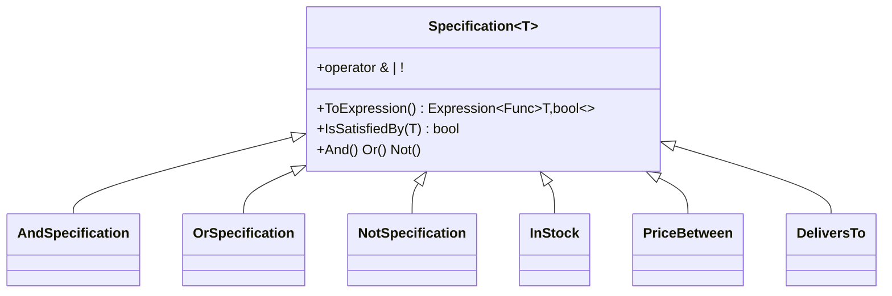

# Specification

> **Status:** the base class lives in the SharedKernel (Phase 0). The catalog specifications
> (`InStock`, `PriceBetween`, `DeliversTo`, `SellerRating`) and the integration test proving they run
> as SQL in PostgreSQL arrive in Phase 1 (Catalog).

## Problem

Customers filter the catalog by combining conditions, for example *in stock, between 500 and
2 000 MZN, in the "Mercearia" category, delivered to Matola, from sellers rated 4 or more*. The same
rules are reused elsewhere: the order validation chain checks "delivers to the customer's zone" and
promotions check "product in category". The filtering must run **in the database**, because the
catalog is too large to load into memory.

## Naive solution

```csharp
var query = db.Products.AsQueryable();
if (filter.InStock) query = query.Where(p => p.Stock > 0);
if (filter.MinPrice is { } min) query = query.Where(p => p.Price >= min);
if (filter.City is { } city) query = query.Where(p => p.Seller.DeliveryZones.Any(z => z.City == city));
// ...repeated, slightly differently, in OrderValidation and in Promotions
```

Why it hurts:

- each rule is duplicated in every place that needs it;
- an `OR` between rules is awkward to express;
- the rule can't be unit-tested on its own;
- a well-meant refactor such as `Where(p => IsDeliverable(p))` compiles fine but silently pulls the
  whole table into memory.

## Solution

A `Specification<T>` exposes its rule as an `Expression<Func<T, bool>>`. Specifications compose with
`&`, `|` and `!`. When two specifications are combined, their **parameters are rebound into one
lambda** instead of being wrapped in `Expression.Invoke`. The result stays a plain expression tree
that EF Core can translate to SQL, and the same rule can be evaluated in memory with
`IsSatisfiedBy`.



## Where in the code

- [Specification.cs](../../src/Kanimambo.SharedKernel/Specifications/Specification.cs)
- [SpecificationExtensions.cs](../../src/Kanimambo.SharedKernel/Specifications/SpecificationExtensions.cs):
  `IQueryable<T>.Where(spec)`

## Tests

- [SpecificationTests](../../tests/Kanimambo.SharedKernel.UnitTests/Specifications/SpecificationTests.cs)
  cover `And`, `Or`, `Not` and `All`, and assert that a composed expression has a single parameter
  and no `InvocationExpression` nodes, which is what makes it translatable.
- *(Phase 1)* Catalog integration test against PostgreSQL that inspects the generated SQL.

## Trade-offs & when NOT to use

- **Translation is the author's job.** A specification is only as translatable as the expression
  inside it: calling a C# method in `ToExpression()` still breaks SQL translation, so each
  specification needs an integration test.
- **Use it only for rules that are reused or combined.** A filter used in exactly one query is
  clearer as an inline `Where`.
- **Don't push specifications through repositories that return `IQueryable`.** Repositories accept a
  specification and return materialized results, so `IQueryable` never leaves Infrastructure.
