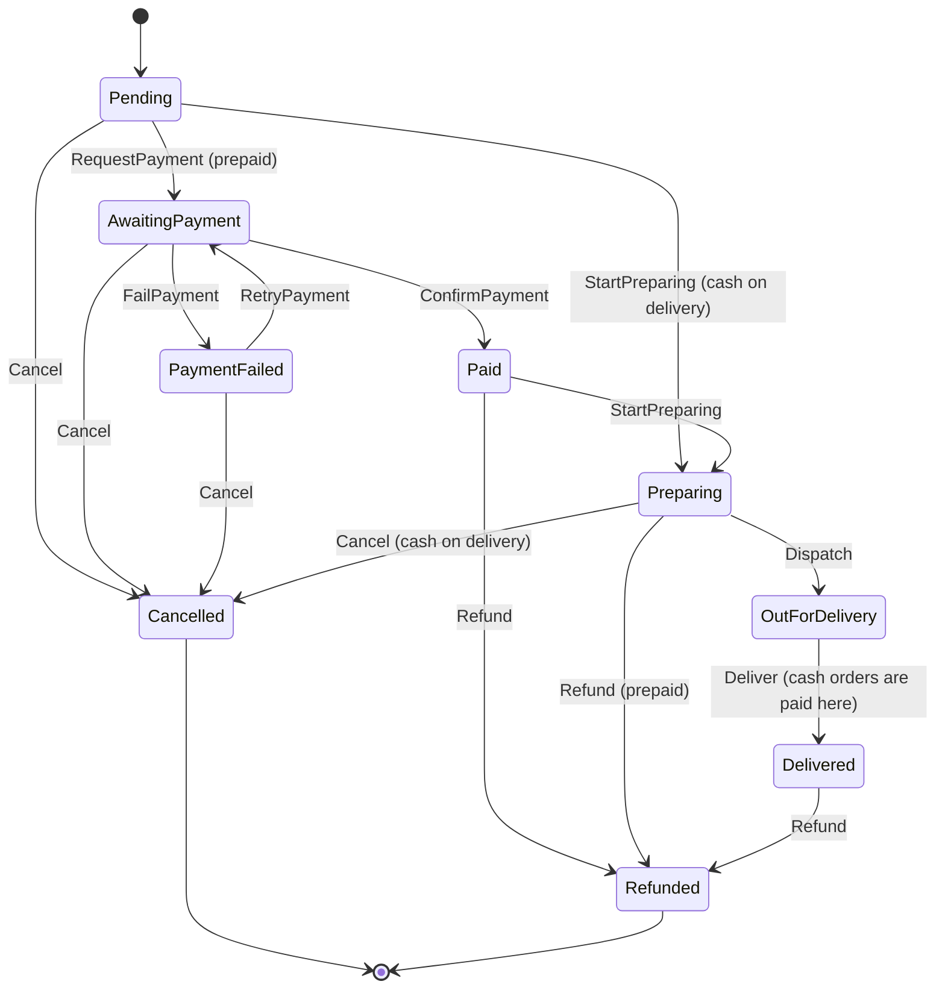

# State

## Problem

An order moves through `Pending → AwaitingPayment → Paid → Preparing → OutForDelivery → Delivered`, and
can branch to `Cancelled`, `PaymentFailed` or `Refunded`. What is allowed depends on the status, and in
Mozambique also on how the customer pays:

- an M-Pesa order must be paid before it is prepared;
- a cash-on-delivery order is prepared straight away, and only counts as paid when the courier collects
  the money;
- a paid order is refunded, not cancelled.

An invalid transition (dispatching an unpaid M-Pesa order, refunding an unpaid cash order) must be
impossible, not merely discouraged.

## Naive solution

```csharp
public void Dispatch()
{
    if (Status == "Preparing") Status = "OutForDelivery";
    else if (Status == "Paid" && PaymentMethod == "COD") ...   // which combinations are valid? scattered
    else throw new InvalidOperationException();
}
// …the same switch repeated in Cancel, Refund, Deliver; one forgotten case ships an unpaid order.
```

## Solution

Each status is an `OrderState` object. Every action is **refused by default** in the base class, and a
state opens only the transitions it overrides:

- `Order` delegates each action to its current state (`Order.Dispatch(now) => State.Dispatch(this, now)`)
  and only knows how to **record** a transition. That means status history, an `OrderStatusChanged` event,
  and `OrderPaid` when payment happens.
- The payment rule lives in the states. `Pending` accepts `RequestPayment` for prepaid orders but
  `StartPreparing` only for cash on delivery; `OutForDelivery.Deliver` raises `OrderPaid` for cash orders.
- `AllowedActions` is derived from the same states, so the API shows clients exactly what they can do next.



The mobile-money payment lifecycle (`Initiated → AwaitingCustomerPin → Confirmed / Failed / TimedOut`)
gets its own states in Phase 4 (Payments).

## Where in the code

- [OrderStates.cs](../../src/Modules/Ordering/Kanimambo.Ordering.Domain/OrderStates.cs) (states)
- [Order.cs](../../src/Modules/Ordering/Kanimambo.Ordering.Domain/Order.cs) (context)
- [OrderRequests.cs](../../src/Modules/Ordering/Kanimambo.Ordering.Application/OrderRequests.cs)
  (`ChangeOrderStatus`)
- `POST /api/orders/{id}/transitions/{transition}` (back-office) and `POST /api/orders/{id}/cancel` (owner)

## Tests

- [OrderStateTests](../../tests/Kanimambo.Ordering.UnitTests/State/OrderStateTests.cs) are
  **exhaustive**: every reachable state × every action, for prepaid and cash-on-delivery orders
  (270 cases).
  - An allowed action reaches the expected state and records history.
  - Anything else is refused, leaves the status unchanged and raises no event.
  - `AllowedActions` matches the table.
  - `OrderPaid` fires on confirmation (prepaid) or on delivery (cash).
- [LifecycleAndOutboxTests](../../tests/Kanimambo.Ordering.IntegrationTests/LifecycleAndOutboxTests.cs)
  cover the full cash-on-delivery flow over HTTP, and an invalid transition returning
  `409 ordering.invalid_transition`.

## Trade-offs & when NOT to use

- **One class per state.** For three states and two transitions, an enum and a guard clause read better.
- **Payment-dependent rules sit inside the states.** If more such variations appear, a state
  per (status, payment kind) or a transition table may scale better.
- **Persistence still uses an enum.** The status is stored as text; the state object is looked up from
  it. Never persist state objects.
