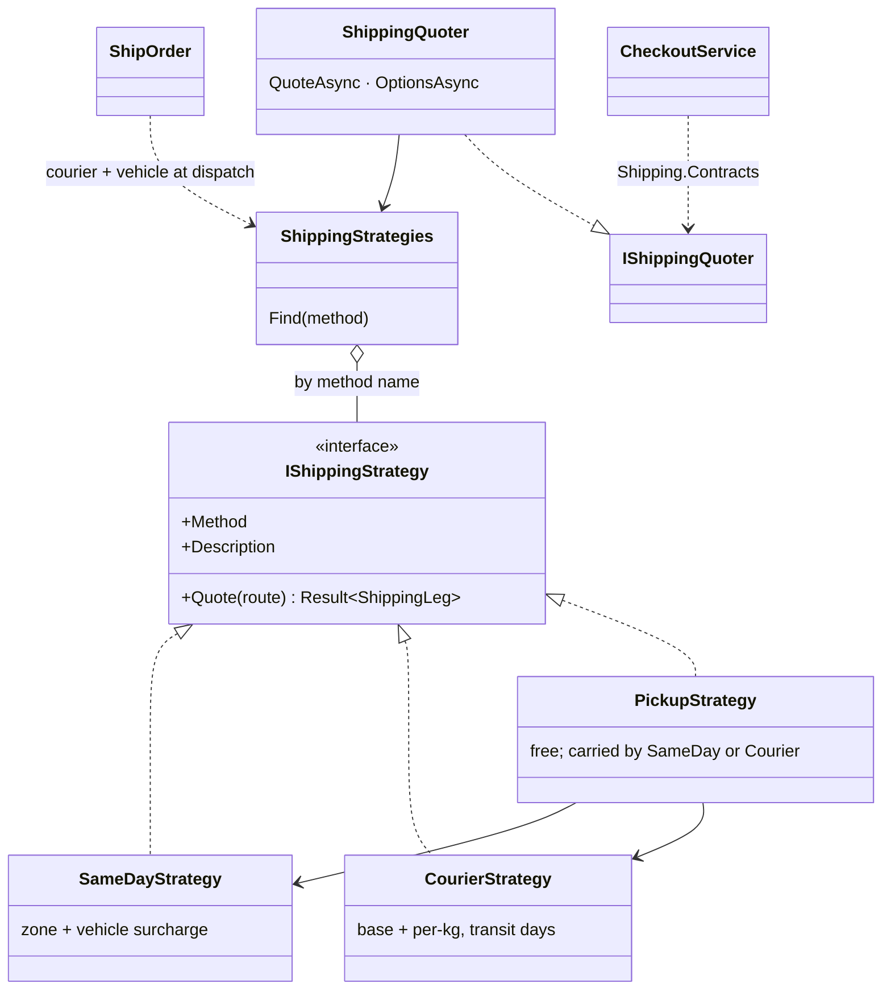

# Strategy

## Problem

Delivery in Mozambique works in very different ways depending on where the goods go:

- **Same day in Maputo and Matola**, by motorbike or *txopela*. The price depends on the customer's
  zone (KaMpfumo is not KaTembe) and on the vehicle the weight needs. Orders placed after the cut-off
  arrive the next day.
- **By courier (transportadora) to the provinces.** The price is a base fee per destination (Beira,
  Nampula…) plus a rate per kilogram, and delivery takes that destination's transit days.
- **Collection at a pickup point.** Free for the customer. The parcel still has to get there, by the
  same-day riders inside Maputo and Matola, or by courier elsewhere.

Each rule has its own inputs, limits and reasons to refuse. New methods come up regularly: express
within two hours, scheduled delivery. Prices change with fuel, so none of them can be hard-coded.

## Naive solution

```csharp
decimal Fee(string method, string city, string? district, decimal kg) => method switch
{
    "SameDay" => district switch { "KaMpfumo" => 150, "KaMavota" => 220, _ => 300 } + (kg > 20 ? 200 : 0),
    "Courier" => city switch { "Beira" => 450 + Math.Max(0, Math.Ceiling(kg) - 5) * 25, ... },
    "Pickup"  => 0,   // …but can it reach Lichinga? Which courier carries it?
    _ => throw new ArgumentException(method),
};
// The same switch reappears for ETAs, for "which courier", and in the options endpoint.
// Every new method edits all of them, and the prices are frozen in code.
```

## Solution

`IShippingStrategy` is one way of delivering and pricing a parcel. It has a name (`Method`), a
`Description`, and `Quote(route)`, which returns a `ShippingLeg` or a typed refusal:
`shipping.not_served`, with the reason why.

| Strategy | Prices by | Refuses when |
|---|---|---|
| `SameDayStrategy` | the customer's zone (district → zone A/B/C), plus the smallest vehicle that carries the weight | the seller or customer is outside Maputo/Matola, the district is not in a zone, or the parcel is heavier than a txopela carries |
| `CourierStrategy` | the destination's base fee, plus the per-kg rate above the included weight | there is no rate for the destination, or the parcel is over the limit |
| `PickupStrategy` | free; reuses same-day or courier to know who carries the parcel there and when | there is no point in the city, the parcel is over the point's limit, or no courier reaches it |

**Selection never uses a switch:**

- **Registry.** `ShippingStrategies` is a dictionary of the registered strategies, keyed by method name.
- **Explicit method.** When checkout names a method, the registry finds it, and an unknown name lists
  the valid ones.
- **No method.** `Shipping:DefaultMethods` (`["SameDay", "Courier"]`) is a preference order: the
  first strategy that can serve the order wins. A Beira order falls through to `Courier` on its own.
- **Delivery options.** `GET /api/shipping/options` asks every strategy and lists the ones that
  serve the order, cheapest first.

**Multi-seller orders:** each seller ships one parcel from their own city, and `ShippingQuoter`
quotes every parcel with the chosen strategy. The fees add up, and the slowest parcel sets the
delivery date.



**Adding a delivery method** means writing one class, adding one DI line in
`AddShippingModule`, and adding its configuration. Nothing existing changes, and a unit test proves
it: an `Express` strategy is registered, and the quoter finds it by name.

All zones, districts, vehicle limits and surcharges, per-destination rates, transit days, the
cut-off and the pickup points live in the `Shipping` section of `appsettings.json`.

## Where in the code

- [ShippingStrategies.cs](../../src/Modules/Shipping/Kanimambo.Shipping.Application/Pricing/ShippingStrategies.cs)
  (the interface and the three strategies)
- [ShippingQuoter.cs](../../src/Modules/Shipping/Kanimambo.Shipping.Application/Pricing/ShippingQuoter.cs)
  (`ShippingStrategies` registry and `ShippingQuoter`)
- [ShippingOptions.cs](../../src/Modules/Shipping/Kanimambo.Shipping.Application/Pricing/ShippingOptions.cs) and the
  `Shipping` section of [appsettings.json](../../src/Kanimambo.Api/appsettings.json)
- Registration: [ShippingInfrastructureExtensions.cs](../../src/Modules/Shipping/Kanimambo.Shipping.Infrastructure/ShippingInfrastructureExtensions.cs)
- Used by checkout ([CheckoutService.cs](../../src/Modules/Ordering/Kanimambo.Ordering.Application/Checkout/CheckoutService.cs))
  through `Kanimambo.Shipping.Contracts.IShippingQuoter`, and by `ShipOrder` at dispatch to know each parcel's courier and vehicle.
- `GET /api/shipping/options?cartId=&district=&pickupPointId=` and `GET /api/shipping/pickup-points?city=`

## Tests

- [SameDayStrategyTests](../../tests/Kanimambo.Shipping.UnitTests/Strategy/SameDayStrategyTests.cs), [CourierStrategyTests](../../tests/Kanimambo.Shipping.UnitTests/Strategy/CourierStrategyTests.cs), [PickupStrategyTests](../../tests/Kanimambo.Shipping.UnitTests/Strategy/PickupStrategyTests.cs):
  - same-day:
    - zone fees by district, and the city's default zone;
    - motorbike or txopela by weight, including the 20 kg boundary;
    - routes out of the area and districts outside the zones are refused;
    - the 14:00 Maputo cut-off decides between today and tomorrow (with `FakeTimeProvider`);
  - courier:
    - base fee plus every started kilogram;
    - transit days per destination;
    - unknown destinations and overweight parcels are refused;
  - pickup:
    - free, carried by Txova in Maputo and by Mbila to Beira;
    - the default point is the first one in the city;
    - the point must be in the customer's city, within its weight limit, and reachable by a courier.
- [ShippingQuoterTests](../../tests/Kanimambo.Shipping.UnitTests/Strategy/ShippingQuoterTests.cs):
  - methods are found by name (case-insensitive), and an unknown name lists the registered ones;
  - preference fallback: Beira goes to Courier;
  - multi-seller fees add up, with a vehicle per parcel;
  - one parcel a method can't carry refuses the whole method;
  - options are listed cheapest first;
  - a **new strategy works without changing the quoter**.
- [ShippingQuoteTests](../../tests/Kanimambo.Shipping.IntegrationTests/ShippingQuoteTests.cs), over HTTP with the real
  configuration:
  - the options for a cart, in order;
  - 12 kg to Beira costs 625 MZN with a delivery date three days out;
  - a 25 kg same-day order goes by txopela;
  - an unknown method returns 400;
  - pickup orders are free.

## Trade-offs & when NOT to use

- **Two fixed rules don't need it.** If prices never change and there are only two rules, a
  configured table plus an `if` is simpler.
- **Strategies need a shared input.** `ShipmentRoute` has to cover every strategy (district, pickup
  point). If future strategies need very different inputs, that record grows or turns into a bag of
  optional fields.
- **One strategy depends on others.** `PickupStrategy` reuses the same-day and courier rules to
  decide who carries a parcel to the point. That is deliberate, so the coverage rules live in one
  place, but it means those strategies are not fully independent.
- **Quoting runs twice.** It happens at checkout (the price the customer pays) and again at dispatch
  (courier and vehicle). If the configuration changes in between, the courier choice follows the new
  rules, but the order keeps the fee it was sold with.
