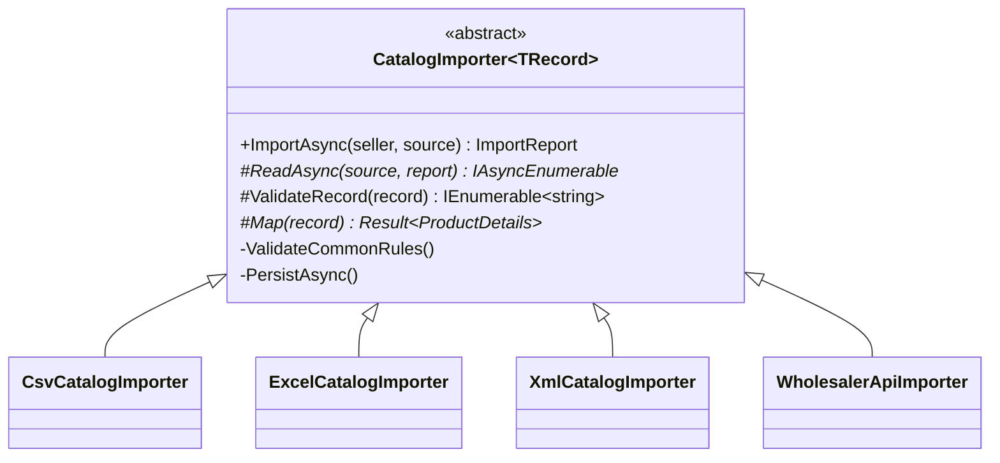

# Template Method

## Problem

Sellers send their catalogs in whatever they have:

- a **CSV** exported from a spreadsheet, with `;` separators and Portuguese decimals (`1.250,50`);
- an **Excel** workbook;
- the wholesaler's **XML** export (Portuguese element names, unit codes like `SC25KG`, weight in
  grams);
- or no file at all: the wholesaler's **API**.

Every import must do the same things in the same order:

1. read the records;
2. validate them;
3. map them to products;
4. persist them in batches;
5. report which rows were accepted and why each rejected row was rejected.

## Naive solution

Four independent importers, each with its own loop:

```csharp
public async Task<Report> ImportCsv(Stream s) { /* read, validate, map, save, report */ }
public async Task<Report> ImportExcel(Stream s) { /* the same skeleton again, with small differences */ }
public async Task<Report> ImportXml(Stream s) { /* ...and again: one forgets the duplicate-SKU rule,
                                                   another saves everything in one huge batch */ }
```

Why it hurts: the skeleton is copied, so the shared rules drift between formats:

- no duplicate SKU within one file;
- the tax category must be known;
- product invariants;
- batch size;
- the report format.

## Solution

`CatalogImporter<TRecord>.ImportAsync` is the **template method**. It is deliberately non-virtual, so
subclasses can't reorder or skip steps. Each format supplies only what differs:

| Step | Who decides | CSV | Excel | XML | Wholesaler API |
|---|---|---|---|---|---|
| **Read** (abstract) | format | separator detection, quoted fields | first sheet, header row | streamed `XmlReader`, root currency | [Iterator](Iterator.md) over pages |
| **Validate** (hook) | format | column count | numeric cells must be numbers | required elements/attributes | price > 0 |
| **Map** (abstract) | format | `1.250,50` decimals | typed cells | unit codes, grams → kg | cents → MZN |
| Common rules | **template** | product invariants, known tax category, no duplicate SKU in the file | | | |
| **Persist** | **template** | batches of 200 through `ICatalogBatchWriter` (upsert by SKU, change tracker cleared) | | | |
| **Report** | **template** | accepted / created / updated, rejected rows with line and reasons; fatal errors | | | |



Two kinds of failure are reported differently:

- **Row errors** go into the report, and the valid rows are kept.
- **An unreadable source** (missing columns, malformed XML, not a workbook) is a fatal error. The
  command returns `422 catalog.import_unreadable`, and the unit of work rolls back anything already
  flushed.

## Where in the code

- Template:
  [CatalogImporter.cs](../../src/Modules/Catalog/Kanimambo.Catalog.Application/Imports/CatalogImporter.cs);
  model:
  [ImportModel.cs](../../src/Modules/Catalog/Kanimambo.Catalog.Application/Imports/ImportModel.cs)
- Formats:
  [Imports/](../../src/Modules/Catalog/Kanimambo.Catalog.Infrastructure/Imports)
  (`CsvCatalogImporter`, `ExcelCatalogImporter`, `XmlCatalogImporter`, `WholesalerApiImporter`)
- Persist step:
  [CatalogBatchWriter.cs](../../src/Modules/Catalog/Kanimambo.Catalog.Infrastructure/Persistence/CatalogBatchWriter.cs)
- Endpoints:
  [CatalogImportsController.cs](../../src/Modules/Catalog/Kanimambo.Catalog.Api/Controllers/CatalogImportsController.cs)

## Tests

- [CatalogImporterTests](../../tests/Kanimambo.Catalog.UnitTests/TemplateMethod/CatalogImporterTests.cs)
  cover:
  - every CSV rejection reason, by line;
  - missing columns being fatal;
  - batches of 200/200/50;
  - Excel text in a numeric cell;
  - XML unit codes, grams and root currency;
  - malformed XML being fatal.
- [ImportApiTests](../../tests/Kanimambo.Catalog.IntegrationTests/ImportApiTests.cs) cover, against
  PostgreSQL:
  - creating and updating rows;
  - rolling back an unreadable file;
  - rejecting unsupported types;
  - importing from the wholesaler API.

## Trade-offs & when NOT to use

- **Inheritance couples formats to the base class.** A change to the skeleton affects every format.
  That's the point here, but it's rigid if formats ever need truly different pipelines; then Strategy
  objects per step would be the better choice.
- **Hooks are only as good as their contracts.** Keep them few and well named; a template with ten
  optional hooks is harder to follow than the duplication it removed.
- **Not for a single format.** Then the abstraction has no second case to justify it.
