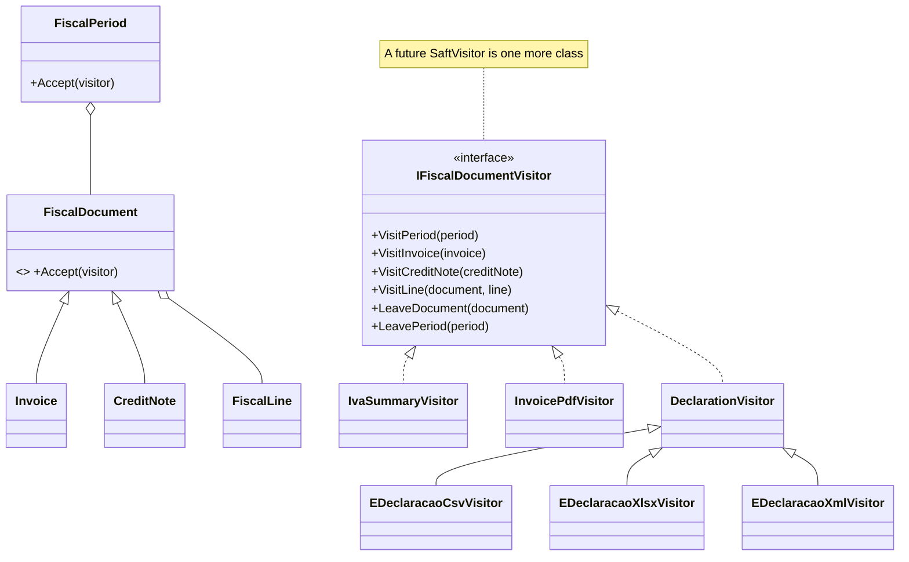

# Visitor

## Problem

Every month, each seller's fiscal documents (invoices and credit notes, with their lines and tax
rates) must be turned into several outputs:

- **the monthly file for the AT's e-Declaração portal**, as CSV, XLSX or XML;
- **the PDF** of each document, for the customer and the seller;
- **the IVA summary** per rate: what the seller owes, with credit notes subtracting;
- **SAF-T (Moçambique)** later, which is not mandatory yet but expected.

The document classes should stay stable fiscal records. They must not grow a `ToCsv()`, `ToXml()`,
`ToPdf()` and `ToSaft()` each time a format appears.

## Naive solution

```csharp
foreach (var doc in documents)
{
    if (doc is Invoice i)      { csv.Append(...); xml.Append(...); summary[...] += ...; }
    else if (doc is CreditNote c) { csv.Append(...); xml.Append(...); summary[...] -= ...; }   // easy to forget a branch
}
// …or worse, ToCsv/ToXml/ToPdf methods on Invoice and CreditNote, and a new pair for every format.
```

## Solution

The documents form a tree: `FiscalPeriod` (issuer, month) → `FiscalDocument` (`Invoice` or
`CreditNote`) → `FiscalLine`. Each node accepts an `IFiscalDocumentVisitor` and controls the walk.

- **Double dispatch.** `Invoice.Accept(v)` calls `v.VisitInvoice(this)`, while a credit note calls
  `v.VisitCreditNote(this)`. Then each line goes to `v.VisitLine(document, line)`, and finally
  `v.LeaveDocument(document)` is called.
- **The period frames the walk.** `FiscalPeriod.Accept(v)` calls `VisitPeriod` and `LeavePeriod`
  around the documents, in date and number order.
- **Optional hooks.** `VisitPeriod`, `LeaveDocument` and `LeavePeriod` are default interface methods,
  so a visitor that doesn't need them (the PDF) doesn't implement them.

| Visitor | Output |
|---|---|
| `EDeclaracaoCsvVisitor` | monthly file, one row per document and tax rate |
| `EDeclaracaoXlsxVisitor` | the same as an Excel workbook (ClosedXML) |
| `EDeclaracaoXmlVisitor` | the same as XML (behind the feature flag `Invoicing.EDeclaracaoXml`) |
| `InvoicePdfVisitor` | one document as PDF, with the regime's title and legal notice |
| `IvaSummaryVisitor` | net, IVA and gross per category and rate; credit notes subtract |

The three monthly-file visitors share `DeclarationVisitor`, which gathers each document's lines into
tax buckets. Each format only writes a finished document. `MonthlyDeclarationExporter` picks the
visitor from a table keyed by format.

> The monthly file follows the information the e-Declaração portal asks for when invoices are
> communicated. The exact column layout is ours, so check it against the AT's current template
> before filing.



**SAF-T** will be a new `SaftVisitor`, with no change to `Invoice`, `CreditNote` or `FiscalLine`. A
unit test shows the idea with a throwaway visitor that counts lines.

## Where in the code

- Tree and interface: [FiscalDocuments.cs](../../src/Modules/Invoicing/Kanimambo.Invoicing.Domain/FiscalDocuments.cs)
- IVA summary: [IvaSummaryVisitor.cs](../../src/Modules/Invoicing/Kanimambo.Invoicing.Application/Visitors/IvaSummaryVisitor.cs)
- Monthly files, the PDF visitor and the exporter: [DocumentVisitors.cs](../../src/Modules/Invoicing/Kanimambo.Invoicing.Infrastructure/Documents/DocumentVisitors.cs)
- Endpoints:
  - `GET /api/invoicing/e-declaracao/{nuit}/{year}/{month}?format=csv|xlsx|xml`
  - `GET /api/invoicing/iva-summary/{nuit}/{year}/{month}`
  - `GET /api/invoicing/documents/{id}/pdf`

## Tests

- [VisitorTests](../../tests/Kanimambo.Invoicing.UnitTests/Visitor/VisitorTests.cs), over one period
  with two invoices and a credit note:
  - the IVA summary per rate, with the credit note subtracted;
  - CSV rows, including the credit note's reference to its invoice;
  - XML is well-formed (`XDocument.Parse`);
  - the XLSX opens with every row;
  - the PDF is structurally valid: every xref offset points at its object;
  - a new visitor works without touching the documents.
- [InvoicingTests](../../tests/Kanimambo.Invoicing.IntegrationTests/InvoicingTests.cs):
  - CSV and XLSX downloads, and XML returns 404 while its flag is off;
  - the PDF download;
  - after a refund, the month's IVA summary nets to zero.

## Trade-offs & when NOT to use

- **New node types are expensive.** Adding one (for example a *nota de débito*) means a new method
  on every visitor. The pattern suits trees that rarely change and outputs that often do, as here.
- **Visitors can only see what nodes expose.** That is fine for fiscal documents, which are public
  records anyway.
- **Not needed for one or two outputs.** A method on the document is simpler then.
